# EStudioUI

A C++20 application framework prototype, currently centered on GLFW windows,
analytic GPU shapes and text, typed signals, and CSS styling. Controls include
buttons, checkboxes/radio groups, read-only/editable combos, scrolling forms, splitters,
progress/help controls, single-line UTF-8 text boxes, tabs, lists, trees,
editable tables, toolbars/tool buttons, menu bars, nested command menus, asynchronous dialogs/popovers, and embedded 3D surfaces. Dependencies are managed with a pinned vcpkg
manifest; no Qt or commercial SDK is required.

Development follows the [framework foundation roadmap](FOUNDATIONS_ROADMAP.md)
before broad widget expansion. The [widget roadmap](WIDGET_ROADMAP.md) records
the planned controls, document editor, and application workspace. Both distinguish
current capabilities from proposed work and define delivery prerequisites.
The [developer experience principles](DEVELOPER_EXPERIENCE.md) make simple,
safe application code an acceptance requirement for every foundation change.

F09 input/actions/focus, F11 platform contracts, and F10a essential control text
are implemented. The first common-control batch is delivered in 0.18; command/dialog controls follow in 0.19. Remaining widget families
and application workspaces continue through the roadmap. F10b document editing is a later track. F14 module extraction and SDK
packaging are deferred until that use informs reusable boundaries, including
services for applications without a UI. Standalone modules are planned, not
current package capabilities; see the roadmaps for acceptance criteria.

## Commands, dialogs and rich CSS (0.19)

The demo opens **Menus & dialogs**. MenuBar reuses shared commands and nested
ContextMenu presentations with GPU glyph icons, checked actions and shortcut
hints. Popup supplies anchored interactive content; Dialog, MessageBox,
InputDialog and DialogButtonBox return asynchronous results without nested event
loops. Dialogs stay centered during resize; anchored surfaces follow layout and
transforms. Input prompts return owned validated text, and modeless tools keep
the workspace interactive.

See [COMMAND_DIALOGS.md](COMMAND_DIALOGS.md), the compiled
[example](examples/CommandDialogs.cpp) and
[verification](verification/COMMAND_DIALOGS_0_19.md). `.\Build.ps1 -Run` still
installs the pinned dependencies, compiles, tests and launches in one shot.

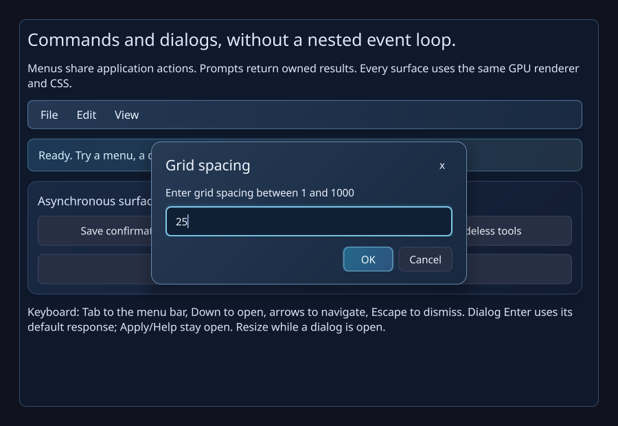

## Essential widgets and rich CSS (0.18)

The **Essential widgets** tab contains working three-state checkboxes, exclusive
radio groups, read-only/editable combos, scrolling forms, splitters, titled/checkable
groups, frames/separators, progress/busy indicators and delayed tooltips. Rich CSS
styles the actual control parts through the existing GPU renderer. The searchable
popup is virtualized and tested with 100,000 records; static controls retain their
pixels and stopped/hidden busy indicators stop requesting frames.

See [COMMON_CONTROLS.md](COMMON_CONTROLS.md), the compiled
[small example](examples/CommonControls.cpp), and
[verification](verification/WIDGETS_0_18.md). On Windows, `.\Build.ps1 -Run`
installs the pinned dependencies, builds, runs the selected checks and opens the gallery.

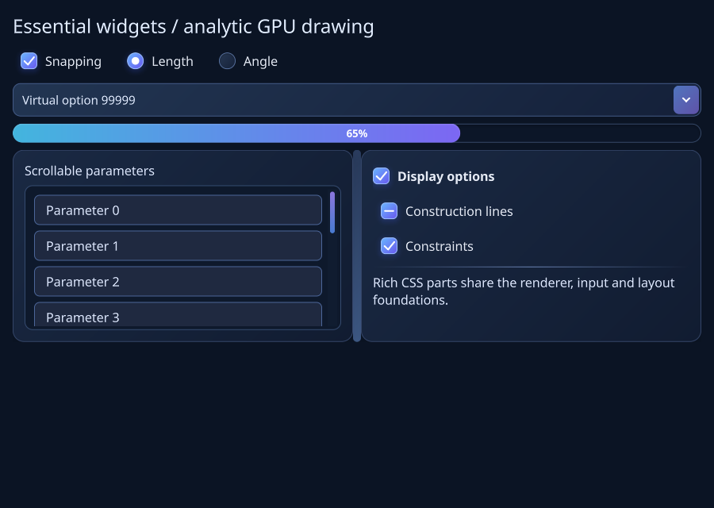

## Control typography and bidirectional text (0.17)

Open **Text & fonts** for fallback captions, real weight/italic selection,
mixed-direction single-line editing and wrapping labels. Inherited CSS selects
families, weight, style, direction and language; selections, pointer hits, visual
arrow navigation and preedit share shaped geometry. GPU glyph identities include
the actual font instance. CPU and GPU text caches have explicit budgets and
retirement. See [TEXT.md](TEXT.md), the compiled [example](examples/ControlText.cpp),
and [verification](verification/TEXT_0_17.md) for supported behavior and limits.

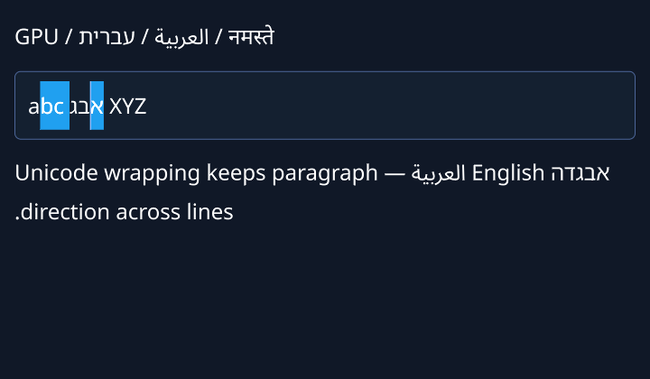

## Native services, composition and accessibility (0.16)

Use the **Platform services** header button for a working clipboard, asynchronous
file/folder picker, file-drop, owned-window and semantic-inspection gallery.
Windows adds rich clipboard formats, native STA pickers, IME composition, and
UI Automation for controls, virtual collection items and single-line text ranges. Headless adapters are deterministic;
capabilities explicitly distinguish native, emulated and unsupported services.
See [PLATFORM.md](PLATFORM.md), the compiled
[platform example](examples/PlatformServices.cpp), and
[verification](verification/PLATFORM_0_16.md). No new third-party dependency.

Preedit is GPU presentation separate from committed text; a commit is one validated
undoable edit. Virtual rows/cells/tree records/canvas items have stable identities
without per-row widgets. Native acceptance results and explicit work budgets are
recorded in the verification guide. Interactive input-method/accessibility/DPI
acceptance remains open and is tracked separately from automated verification.

## Shared actions, input, focus, and popup sessions (0.14)

The 0.14.1 maintenance update fixes retained secondary windows staying visible
after closure, captures after native buffer swaps, and two MSVC numeric-conversion
warnings. Both Async close paths and GPU capture state have regression probes;
see [maintenance verification](verification/WINDOW_CAPTURE_0_14_1.md).

The demo opens **Input & actions** by default. One transactional command can drive
buttons, toolbars, nested menus, split-tool choosers, and scoped shortcuts. Action
handles queue worker requests with receiver/domain lifetime checks. Ambiguous
shortcuts execute neither command; AltGr is kept separate from editing shortcuts.

```cpp
auto save = window.Ui().CreateAction("Save document");
save->SetShortcut({EStudioUI::Key::S, EStudioUI::ShortcutModifier::Primary});
toolbar.AddAction(save);
menu.AddAction(save);
save->Triggered().Connect([] { /* Save the application document. */ });
```

Local Tab scopes and a bounded popup/modal stack provide nested dismissal, logical
CSS ancestry, focus restoration, and asynchronous results without a nested event
loop. Native input retains logical/physical keys, scan codes, source timestamps,
and pointer metadata; reentrant native delivery is queued. Geometry-only refresh
remains usable from input handlers while nested frames/event pumping are guarded.

See [INPUT.md](INPUT.md), the compiled [input example](examples/InputActions.cpp),
and [0.14 verification](verification/INPUT_0_14.md) for APIs and measured limits.
F11 platform composition is described above; F10a control typography is described below.

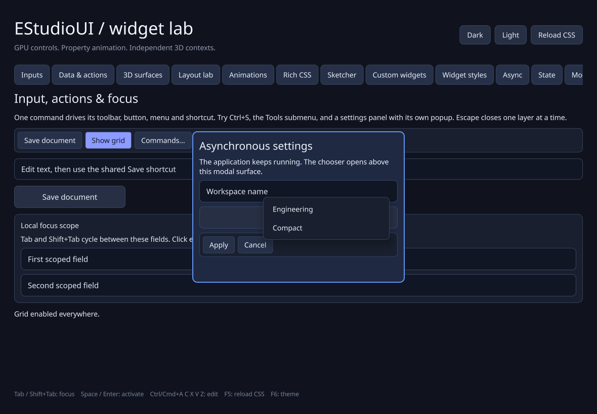

## Linear constraints and live resizing (0.13)

Open **Layout lab → Constraint layouts** for anchored panels, working editors, and aspect
ratios. `ConstraintLayout` accepts linear relationships such as
`field.Left() == sidebar.Right() + 12`, with required rules, weighted soft
preferences, hard widget-size precedence, and named conflict diagnostics.
Its private header-only Kiwi dependency is permissively licensed and installed
by the existing pinned-vcpkg build flow.

Native size/refresh callbacks now present safe frames directly. A Windows modal
resize/menu timer keeps the shared scheduler progressing while the mouse button
is held, using the normal 60 Hz cap and preserving style/intrinsic caches.
See [CONSTRAINT_LAYOUT.md](CONSTRAINT_LAYOUT.md) for the compiled example,
contracts and performance boundaries, and
[0.13 verification](verification/CONSTRAINTS_0_13.md) for measured evidence.

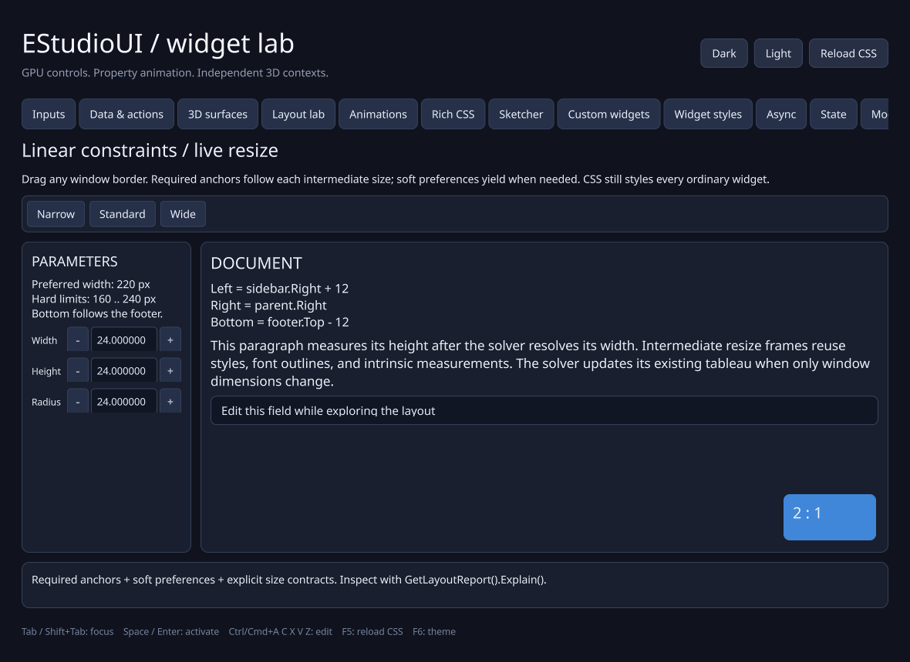

## Predictable measurement and layout (0.12)

The **Layout lab** demonstrates width-dependent labels that measure their
height at the allocated width; forms align painted baselines and share columns;
flow rows wrap working tools; grids share Fixed/Content/Fill track allocation.
Existing explicit sizes retain precedence over CSS. No runtime dependency was added.

```cpp
form.SetLayout(EStudioUI::FormLayout{});
form.SetGap(12);
notes.SetWordWrap(true);
```

Containers accept owned strategy values, including custom LayoutStrategy
implementations. Custom widgets can supply minimum/preferred sizes, baselines,
and height-for-width measurement without changing the GPU paint path. Owned
allocation reports explain child and track rules, caps, overflow, and unresolved
percentage/content cycles. Paint-only changes retain layout caches.

See [LAYOUT.md](LAYOUT.md) for complete examples, sizing/extension contracts,
wrapping boundaries and costs, and [0.12 verification](verification/LAYOUT_0_12.md)
for actual work counts, resize captures and framebuffer comparisons. The optional
linear constraint strategy is delivered separately in 0.13.

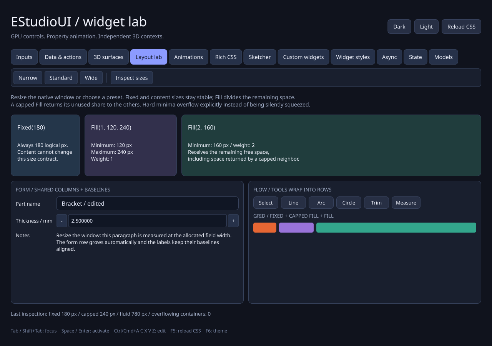

## Shared collection models (0.11)

One typed model can serve lists, tables, and trees with shared stable-ID selection,
independent sort/filter mappings, typed editing, and owned worker snapshots. A
100,000-record **Models** tab demonstrates the actual API, virtual GPU item delegates,
batched changes, and view-local scrolling/expansion. Content-width policies are
explicit; shared tables use bounded sampling by default.

```cpp
auto model = EStudioUI::MakeTableModel(ui.States(), std::move(parts),
    EStudioUI::Column("Name", &Part::m_Name),
    EStudioUI::Column("Length", &Part::m_Length));
auto selection = EStudioUI::SelectionModel::Create(model);
table.SetModel(model);
list.SetModel(model);
table.SetSelectionModel(selection);
list.SetSelectionModel(selection);
```

Include `EStudioUI/Models.h` for the model entry points. See [MODELS.md](MODELS.md)
for complete applications, ownership and transaction contracts, delegate hooks,
external-provider boundaries, and sizing costs. [0.11 verification](verification/MODELS_0_11.md)
records actual counters and framebuffer comparisons. Select Models to open that demo.

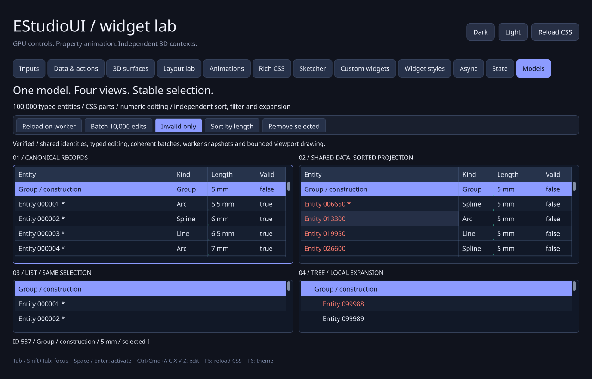

## Typed state and incremental updates (0.10)

Typed values now support validation, immutable snapshots, and coherent batched
commits. Bind existing editors, sliders, labels, toggles, visibility, or enabled
state without writing synchronization callbacks:

```cpp
EStudioUI::State<double> amount(window.Ui().States(), 25.0);
EStudioUI::BindValue(slider, amount);
EStudioUI::BindValue(number, amount);
```

Include `EStudioUI/Bindings.h` for the binding helpers. The **State** tab is a
working example of shared controls, transactional presets and rollback, derived
readouts, and coalesced worker publication. Bindings retire with their receiver
or state. Control-origin validation failures restore the canonical value and
remain inspectable; state-origin candidates are validated before publication.

Content changes now invalidate their measurement dependency path while retaining
unrelated style and intrinsic measurement caches. Paint-only changes keep layout
cached; unchanged layout subtrees are skipped. Selector-dependent changes retain
a conservative selector pass for correctness. Custom widgets can declare their
change impacts through `Invalidate(Invalidation::Content)` or finer flags.
See [STATE.md](STATE.md) and [0.10 verification](verification/STATE_0_10.md).

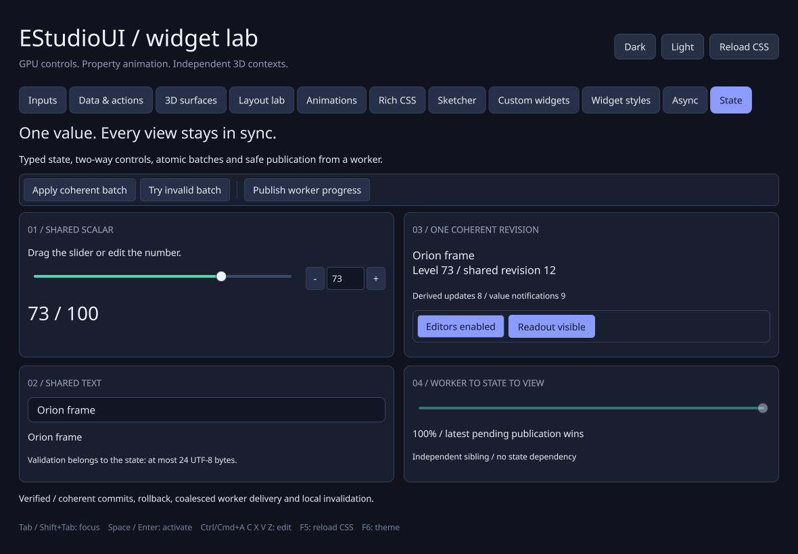

## Execution and lifetime foundations (0.9)

One application loop now services all windows. Typed UI handles queue updates
from workers without exposing widget pointers. Cancellable tasks deliver owned
results to live receivers; request scopes suppress obsolete work, progress
coalesces, and queues have explicit capacity and failure outcomes. Receiver-bound
signals use the same delivery mechanism. Direct UI access has owner-thread
diagnostics, and unsafe structural changes during layout/paint are rejected with
an explicit deferred alternative.

```cpp
auto task = app.Tasks().Run(window.Ui().GetHandle(result),
    [] { return std::string("Calculation complete"); },
    [](EStudioUI::Label& label, std::string text) { label.SetText(std::move(text)); });
```

The **Async** tab builds a 200,000-item scene and BVH on a worker, publishes it
to a live canvas, and demonstrates replacement, cancellation, receiver deletion,
and another window. See [THREADING.md](THREADING.md) for the common workflow and
the exact lifetime/error rules. See [foundation verification](verification/FOUNDATIONS_0_9.md)
for concurrency and actual framebuffer evidence. Shared collection models and
selection are delivered in the 0.11 model foundation described above.

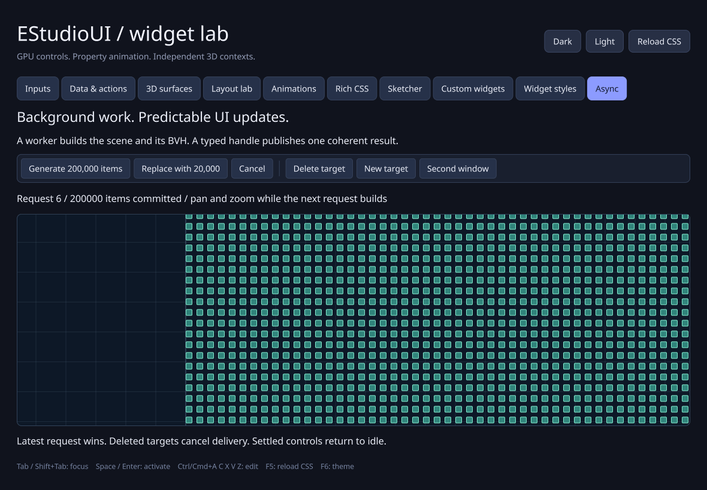

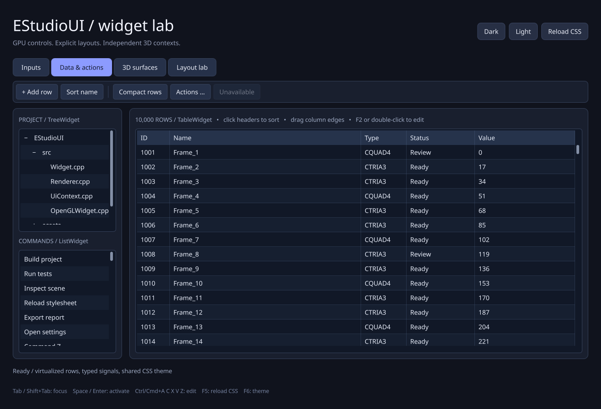

## Rich styling across the toolkit (0.8)

The **Widget styles** tab applies three CSS presets to working text/numeric
inputs, sliders, tabs, toolbars, split buttons, menus, lists, trees, tables,
canvas, custom painting, and the embedded 3D surface. Edit
[assets/rich-widgets.css](assets/rich-widgets.css) and press F5.

Named CSS parts style slider tracks/handles, editor selection/caret/placeholder,
collection items/headers/tree branches, and scrollbars. Validation, focus-within,
orientation, selection, expanded, alternate, and sorted states are available.
Fixed slider parts can animate; virtualized rows use shared cached styles without
per-row widgets or timelines. Existing outer-widget gradients, shadows, transforms,
decorations, transitions, and keyframes remain available throughout the toolkit.
See [WIDGET_STYLING.md](WIDGET_STYLING.md) for examples and the exact contracts.

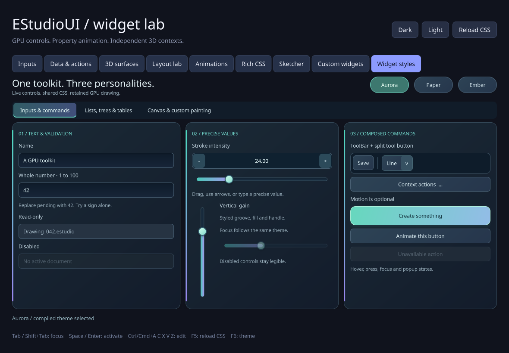

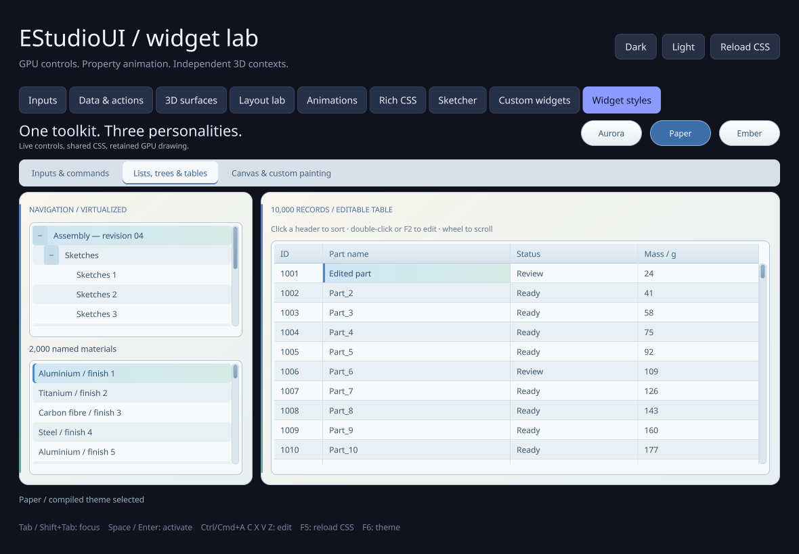

## Canvas, sketcher, and custom controls (0.7)

The **Sketcher** tab is a reusable geometric CAD editor with lines, rectangles,
circles, arcs, cubic Bézier splines, polyline paths, text annotations, and nested
styled groups. It supports outline picking, box selection, movement, snapping,
numeric creation/editing, individual curve control-point editing, duplication,
group/ungroup, undo/redo, and versioned save/open. Double-precision pan and
pointer-centered zoom keep the world independent of screen pixels.

Dense items use contiguous scene data, shared compiled CSS styles, a balanced
BVH, and viewport-only GPU submission. Groups have their own immutable BVHs.
Curve tessellation and text shaping are cached with bounded memory; idle canvases
do not continuously redraw. The **200,000 items** button and `--profile-canvas`
exercise large scenes. See [CANVAS.md](CANVAS.md) for controls, APIs, and limits.

`NumericInput`, `Slider`, input validators, and `SplitToolButton` provide reusable
precision controls. The **Custom widgets** tab demonstrates inheritance,
composition, and a custom GPU-painted dial. `PaintWidget`, `Painter`, and
`PainterPath` expose drawing, clipping, transforms, text, and stroked curves through
the existing GPU command stream. See [INPUT_CONTROLS.md](INPUT_CONTROLS.md) and
[CUSTOM_WIDGETS.md](CUSTOM_WIDGETS.md). No runtime dependency is added.

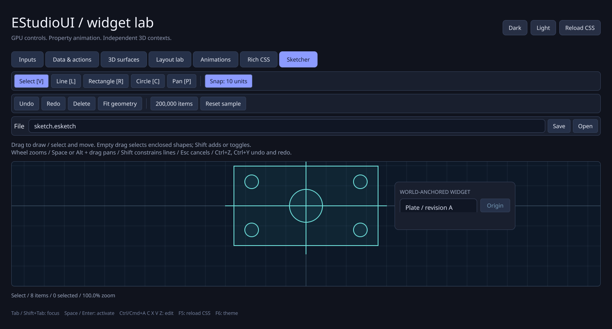

## Rich GPU styling (0.5)

The **Rich CSS** tab contains twelve working button styles and a focusable text
box. Edit [assets/rich-buttons.css](assets/rich-buttons.css) and press F5.
Linear/radial gradients, before/after paint layers, 2D transforms, multiple/inset
shadows, rounded clipping, state transitions, and named keyframes use the existing
OpenGL batch. No runtime dependencies were added. See [CSS.md](CSS.md) for the
exact subset and [ANIMATIONS.md](ANIMATIONS.md) for the C++ animation API.

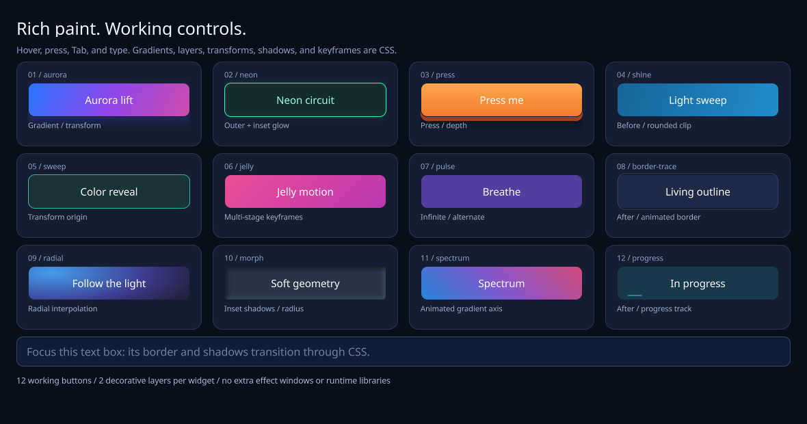

Performance checks assert zero style/layout work during 240 paint-only ticks for
500 widgets. Dense animation remains batched; unchanged frames reuse pixels.
The framebuffer test writes measured baseline/rich frame times and upload counts
to `rich-css-performance.txt`; software GL results do not establish hardware FPS.

Version **0.5.1** retains the rendered window and redraws damaged regions, avoiding
repeated analytic text/effect shading across the whole window. Hidden CSS no
longer requests frames when interacting with another tab. Presentation is capped
at 60 Hz independently of input frequency/vsync, and pauses while minimized or
unfocused. Rich effects and animation timing are preserved. See
[PERFORMANCE.md](PERFORMANCE.md) for the profiler, counters, and measured results.

## One-command Windows build

Prerequisites: **Visual Studio 2022** with **Desktop development with C++**, a
Windows SDK, **C++ CMake tools**, and Git for Windows. CMake must be 3.24 or newer.
The script finds Visual Studio's bundled CMake and Git when needed. No
administrator rights or global `vcpkg integrate install` step is required for
this project's bootstrap/build.

Clone the repository, then install dependencies, compile, run automated tests,
and open the demo with one command:

```powershell
git clone https://github.com/jamedev/EStudioUI.git
cd EStudioUI
powershell -NoProfile -ExecutionPolicy Bypass -File .\Build.ps1 -Run
```

If you want to select your existing central vcpkg checkout explicitly:

```powershell
.\Build.ps1 -VcpkgRoot C:\Development\vcpkg -Configuration Release -Run
```

`Build.ps1` performs these steps:

1. Locate VS 2022 x64 C++ tools, CMake, CTest, and Git.
2. Reuse vcpkg from `-VcpkgRoot`, `VCPKG_ROOT`, PATH, or an ancestor's `vcpkg`
   directory when its tooling is recent enough; otherwise clone/bootstrap a
   private checkout under `.tools/`.
3. Install the four runtime packages from `vcpkg.json` using the custom
   **`x64-windows-estudioui`** triplet.
4. Configure and build the library, demo, and core test executable with MSVC.
5. Run CTest and the demo's native OpenGL framebuffer/input self-test.
6. Open the interactive demo if `-Run` was passed.

A failed step stops the script with a nonzero exit code. The GPU self-test opens
a window, exercises the controls, writes screenshots/reports, and exits without
manual interaction. It requires a driver that exposes OpenGL 3.3 core. Use
`-SkipGpuTest` on a Windows CI runner without that capability; the core tests
still run. `Get-Help .\Build.ps1 -Full` describes all parameters.

```powershell
.\Build.ps1 -Configuration Debug -Jobs 4
.\Build.ps1 -SkipGpuTest
```

Outputs:

| Item | Default path |
| --- | --- |
| Demo | `build/windows-vcpkg/Release/EStudioUIDemo.exe` |
| Debug demo | `build/windows-vcpkg/Debug/EStudioUIDemo.exe` |
| Dependency install tree | `build/windows-vcpkg/vcpkg_installed/x64-windows-estudioui/` |
| GPU verification | `build/windows-vcpkg/verification/Release/` |
| CTest logs | `build/windows-vcpkg/Testing/Temporary/` |

The overlay triplet in `cmake/triplets/` selects x64, static library dependencies,
the MSVC DLL runtime (`/MD`, `/MDd`), and the v143 toolset. Both Debug and Release
packages are built. The application uses the same CRT setting. Keep the demo's
adjacent `assets` and `licenses` directories when copying it elsewhere.

The install tree is local to EStudioUI even when the vcpkg checkout is shared.
Other projects' installed packages and the shared checkout's HEAD are preserved.
`vcpkg-bootstrap.json` pins a tested tooling snapshot separately from the older
library registry baseline. A preferred checkout that predates this tooling
snapshot uses a private `.tools/vcpkg-<revision>` copy; this avoids stale tool
URLs while preserving shared checkouts. Missing historical registry objects are
fetched without checking out another branch in a shared checkout. First-time
setup downloads tools/sources; later runs reuse vcpkg caches and the incremental
application build. Existing nonempty directories are never
replaced with a fresh vcpkg checkout.

## Dependencies and reproducibility

`vcpkg.json` pins registry baseline
`ce613c41372b23b1f51333815feb3edd87ef8a8b` (2025.04.09).

| Package | Version at baseline | Enabled runtime features |
| --- | --- | --- |
| GLFW | 3.4#1 | Core |
| FreeType | 2.13.3 | Core |
| HarfBuzz | 10.2.0#3 | Core |
| utf8proc | 2.10.0 | Core |

Tooling is bootstrapped from `a2f9862da6d88040a8537fb9b8cb24deaa9a196b`;
this keeps Windows build-tool downloads current without changing library versions.
All default features are explicitly disabled. There is no optional GLib, ICU,
Cairo, PNG, Brotli, bzip2, or external zlib dependency. The small generated GLAD
loader, Noto Sans font, and original Slug reference shaders remain in the
repository. Licenses permit commercial use; see
[THIRD_PARTY_NOTICES.md](THIRD_PARTY_NOTICES.md) and `licenses/` for notices and
selected alternatives, including FreeType's FTL.

## Controls, styling, and API

- Buttons have hover/pressed/focus/disabled states, mouse capture, keyboard
  activation with Enter/Space, and a typed `Clicked()` signal.
- Text boxes provide committed Unicode input, grapheme navigation, mouse and
  keyboard selection, double/triple click, clipboard, undo/redo, placeholders,
  read-only mode, and `TextChanged()` / `Submitted()` signals.
- `TabWidget` owns persistent pages and excludes inactive pages from layout/input.
  Arrow/Home/End keys navigate the tab strip; Ctrl+Tab / Ctrl+Shift+Tab switch pages.
  A `...` chooser lists all pages in a virtual scrolling popup; selected and focused
  selectors are minimally revealed when the natural-width row overflows. Arrow
  buttons and horizontal/vertical mouse wheel input scroll the row independently
  of page selection.
- `ListWidget` supports selection, prefix search, activation, keyboard/page
  navigation, and scrolling. `TreeWidget` adds stable IDs and expansion/navigation.
- `TableWidget` supports virtualized rows, cell selection/copying, stable
  lexicographic sorting, resizable columns, and in-place editing. Enter/F2 or a
  double-click edits; Enter/focus loss commits and Escape cancels.
- `ToolBar` contains compact `ToolButton` commands, checked toggles, separators,
  and ordinary child controls. `ContextMenu` uses a popup layer with outside-click
  dismissal, focus restoration, keyboard navigation, and disabled actions.
- `OpenGLWidget` embeds separate shared GL contexts with depth buffers, physical
  framebuffer sizing, input signals, static-scene caching, and optional animation.
- Explicit `Fixed`, `Content`, and weighted `Fill` contracts control sizing. The
  allocator redistributes space after a child reaches its maximum and reports
  overflow when hard limits cannot fit. See [LAYOUTS.md](LAYOUTS.md).
- `AnimationSystem` drives synchronized properties across widgets, with 22 easing
  presets, custom cubic Bezier curves, pause/seek/resume, delay, and repetition.
  `UiContext::AnimateStyleSheet` interpolates complete CSS endpoints automatically.
  Geometry, colors, shadows, typography, and custom setter tracks share one
  timeline. No new runtime dependency is required. See [ANIMATIONS.md](ANIMATIONS.md).
- Tab / Shift+Tab move focus. Ctrl+A/C/X/V/Z/Y and Ctrl+Shift+Z edit text.
- Dark / Light load external CSS. F5 reloads the current file; F6 switches themes.
  Invalid CSS retains the last valid stylesheet and displays a recoverable error.

Edit the executable's adjacent CSS, or point at the source while developing:

```powershell
.\build\windows-vcpkg\Release\EStudioUIDemo.exe --css .\assets\dark.css
```

```css
button.primary { background: #8c9bff; color: #11172b; border-radius: 8px; }
button.primary:hover { background: #a7b2ff; }
textbox:focus { border: 2px solid #8c9bff; }
```

CSS is a documented subset rather than full browser CSS or a drop-in Qt stylesheet
implementation. See [CSS.md](CSS.md) for selectors, properties, cascade, and layout.

Link the CMake target `EStudioUI::EStudioUI` and include headers from `EStudioUI/`:

```cpp
#include <EStudioUI/Button.h>
#include <EStudioUI/Label.h>
#include <EStudioUI/TextBox.h>
#include <EStudioUI/Window.h>

int main()
{
    EStudioUI::Window window({}, "assets/NotoSans.ttf");
    auto& root = window.Ui().Root();
    auto& input = root.Add<EStudioUI::TextBox>();
    input.SetPlaceholder("Your name");
    auto& button = root.Add<EStudioUI::Button>("Say hello");
    auto& result = root.Add<EStudioUI::Label>("Ready");
    button.Clicked().Connect([&input, &result]
    {
        result.SetText("Hello, " + input.GetText());
    });
    std::string error;
    if (!window.Ui().SetStyleSheet("window { padding: 24px; gap: 12px; }", error))
        return 1;
    return window.Run();
}
```

Widgets own children through `unique_ptr`; references last until removal.
Use `UiContext::Observe()` when a callback target may disappear. A `Connection`
does not disconnect when its handle is destroyed; use `Disconnect()` or
`ScopedConnection` for explicit disconnection. Direct signals run synchronously on
the emitter's thread; receiver-bound connections always queue to the receiver's
UI owner and retire when it disappears. Both support connection mutation and
sender deletion. Live widget access remains owner-only; use typed handles for
cross-thread delivery. See [THREADING.md](THREADING.md).

The demo opens on Menus & dialogs. The `...` tab chooser reaches every gallery page.
Data & actions has 10,000 table rows and 2,006 list items.
Only viewport rows are painted. Inputs preserves the original editor/button
examples; 3D surfaces has two independent orbit/zoom scenes; Layout lab exposes
fixed and bounded Fill behavior at different native window sizes.
Animations offers editable CSS endpoints, a typed property group, duration/easing
controls, pause/resume, and repeat/alternate playback.

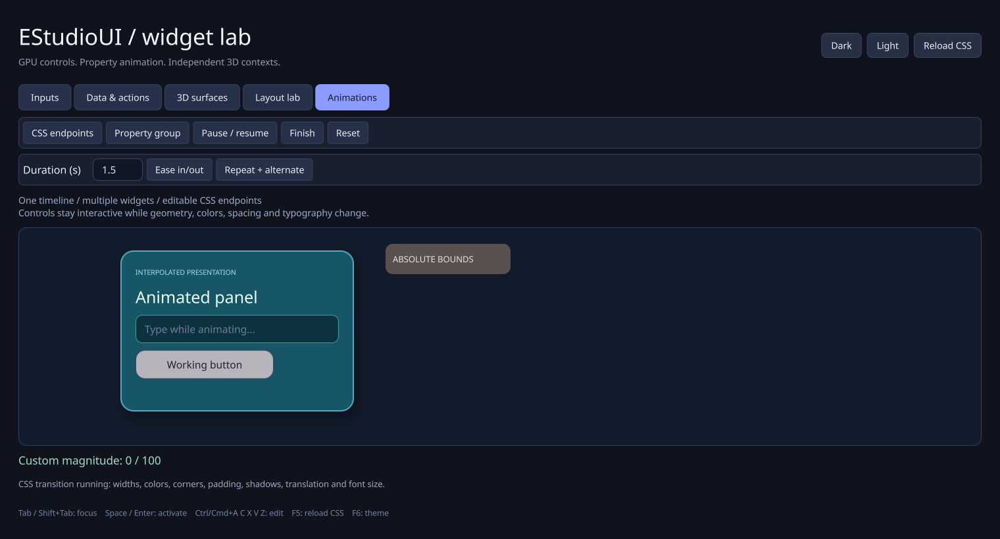

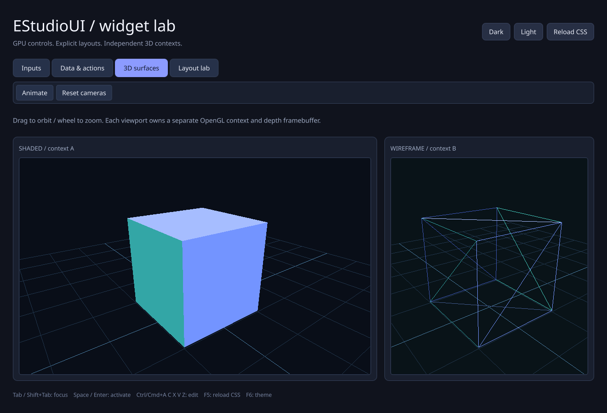

The same one-shot build command installs/builds/tests this gallery. See
[OPENGL_WIDGET.md](OPENGL_WIDGET.md) for scene lifecycle, input, texture sharing,
manual frame driving, and render-thread boundaries.

## Rendering and boundaries

A single ordered instance stream combines rounded boxes, borders, shadows,
selection, carets, and glyphs. The Slug-derived fragment shader evaluates quadratic
font outlines directly, without a bitmap/SDF atlas. Shaping and glyph outlines are
cached, and the event loop sleeps between changes/caret deadlines unless a
visible surface or a property timeline requests animation. Damaged rectangles
use ordered draws; unchanged regions retain their pixels. Embedded textures split
batches where needed to preserve painter order; scene rendering has its own
submissions. The fully redrawn 640-box / 3,840-glyph stress scene uses one draw call.

Pixel reads and PPM captures use the last completed retained GPU framebuffer,
independently of native buffer swaps. They preserve external read/packing state
and require the renderer's owning context to be current. Capturing before the
first completed frame is diagnosed. Readback occurs only when explicitly requested.

This is a prototype: text editing is single-line and left-to-right, with one font
and no font fallback, IME pre-edit integration, full bidi, or color emoji. Layout
supports box, grid, form, flow, and optional linear constraints with explicit size
contracts and constrained measurement. Collections share typed models and stable
selection; menus support nesting. Native accessibility and broader application
widgets remain future work. See [ARCHITECTURE.md](ARCHITECTURE.md) and the roadmaps.

## Linux, manual CMake, and checks

On Ubuntu/Debian, install the normal compiler/build tools, X11 development headers,
a graphics driver, and OSMesa for headless framebuffer tests:

```bash
sudo apt-get install build-essential cmake ninja-build pkg-config curl zip unzip tar \
    xorg-dev libgl1-mesa-dev libosmesa6
export VCPKG_ROOT=/path/to/a/bootstrapped/vcpkg
./scripts/Build-Linux.sh Release --run
```

Windows can also use the `vs2022` CMake preset with `VCPKG_ROOT` set. Preset
configuration installs the manifest automatically; the one-shot script performs
that step explicitly before configuring. Ninja `debug` / `release` presets are
provided for Linux. Disable `ESTUDIOUI_BUILD_DEMO` / `ESTUDIOUI_BUILD_TESTS` when
embedding. The first backend uses OpenGL 3.3 core; macOS is not verified.

```bash
./build/linux-release/EStudioUIDemo --headless --self-test --output verification-local
./build/linux-release/EStudioUIDemo --headless --benchmark --output benchmark-local
./build/linux-release/EStudioUIDemo --headless --profile-ui --output benchmark-local/ui
```

On Windows, use the corresponding EXE path and omit `--headless`. Benchmark
timings include CPU submission and synchronous readback, excluding widget layout
and shaping; use Release and your actual GPU for meaningful performance results.

For paced rendering captures without measured-frame readbacks, run
`.\scripts\Profile-Rendering.ps1`. It builds/tests Release and profiles actual
Rich CSS animations, synchronized and isolated sliders, and text editing/selection.
CPU/frame counters and completed GPU upload/draw/presentation-copy timestamps are
exported with exact frame identities. See [PERFORMANCE.md](PERFORMANCE.md) for
options, the forced-presentation baseline and hardware interpretation.

The repository's workflow builds MSVC 2022 Debug/Release with the same PowerShell
script for core/native CPU checks, plus a staged Win32/WGL framebuffer run with a
SHA-256-pinned Mesa software runtime. The test driver is isolated from system and
application installations. Linux CI runs vcpkg/core/headless-GL checks.
`verification/` contains local test
records and actual framebuffer screenshots. Linux captures use Mesa llvmpipe
software OpenGL; they verify behavior rather than hardware GPU throughput.
