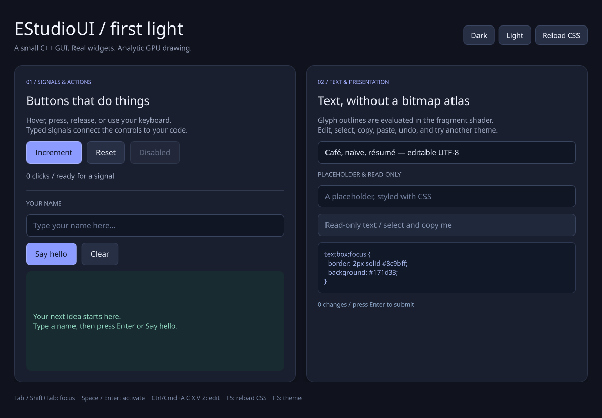

# EStudioUI

A C++20 GUI toolkit prototype with GLFW windows, analytic GPU shapes and text,
typed signals, and CSS styling. The first controls are working buttons and
single-line UTF-8 text boxes. Dependencies are managed with a pinned vcpkg
manifest; no Qt or commercial SDK is required.



## One-command Windows build

Prerequisites: **Visual Studio 2022** with **Desktop development with C++**, a
Windows SDK, **C++ CMake tools**, and Git for Windows. CMake must be 3.24 or newer.
The script finds Visual Studio's bundled CMake and Git when needed. No
administrator rights or global `vcpkg integrate install` step is required for
this project's bootstrap/build.

Clone the repository, then install dependencies, compile, run automated tests,
and open the demo with one command:

```powershell
git clone https://github.com/jamedev/EStudioUI.git
cd EStudioUI
powershell -NoProfile -ExecutionPolicy Bypass -File .\Build.ps1 -Run
```

If you want to select your existing central vcpkg checkout explicitly:

```powershell
.\Build.ps1 -VcpkgRoot C:\Development\vcpkg -Configuration Release -Run
```

`Build.ps1` performs these steps:

1. Locate VS 2022 x64 C++ tools, CMake, CTest, and Git.
2. Reuse vcpkg from `-VcpkgRoot`, `VCPKG_ROOT`, PATH, or an ancestor's `vcpkg`
   directory; otherwise clone/bootstrap a private checkout under `.tools/vcpkg`.
3. Install the four runtime packages from `vcpkg.json` using the custom
   **`x64-windows-estudioui`** triplet.
4. Configure and build the library, demo, and core test executable with MSVC.
5. Run CTest and the demo's native OpenGL framebuffer/input self-test.
6. Open the interactive demo if `-Run` was passed.

A failed step stops the script with a nonzero exit code. The GPU self-test opens
a window, exercises the controls, writes screenshots/reports, and exits without
manual interaction. It requires a driver that exposes OpenGL 3.3 core. Use
`-SkipGpuTest` on a Windows CI runner without that capability; the core tests
still run. `Get-Help .\Build.ps1 -Full` describes all parameters.

```powershell
.\Build.ps1 -Configuration Debug -Jobs 4
.\Build.ps1 -SkipGpuTest
```

Outputs:

| Item | Default path |
| --- | --- |
| Demo | `build/windows-vcpkg/Release/EStudioUIDemo.exe` |
| Debug demo | `build/windows-vcpkg/Debug/EStudioUIDemo.exe` |
| Dependency install tree | `build/windows-vcpkg/vcpkg_installed/x64-windows-estudioui/` |
| GPU verification | `build/windows-vcpkg/verification/Release/` |
| CTest logs | `build/windows-vcpkg/Testing/Temporary/` |

The overlay triplet in `cmake/triplets/` selects x64, static library dependencies,
the MSVC DLL runtime (`/MD`, `/MDd`), and the v143 toolset. Both Debug and Release
packages are built. The application uses the same CRT setting. Keep the demo's
adjacent `assets` and `licenses` directories when copying it elsewhere.

The install tree is local to EStudioUI even when the vcpkg checkout is shared.
Other projects' installed packages and the shared checkout's HEAD are preserved.
An existing checkout must have a versions database covering the pinned baseline;
a missing historical baseline object is fetched without checking out another
branch. First-time setup downloads tools/sources; later runs reuse vcpkg caches
and the incremental application build. Existing nonempty directories are never
replaced with a fresh vcpkg checkout.

## Dependencies and reproducibility

`vcpkg.json` pins registry baseline
`ce613c41372b23b1f51333815feb3edd87ef8a8b` (2025.04.09).

| Package | Version at baseline | Enabled runtime features |
| --- | --- | --- |
| GLFW | 3.4#1 | Core |
| FreeType | 2.13.3 | Core |
| HarfBuzz | 10.2.0#3 | Core |
| utf8proc | 2.10.0 | Core |

All default features are explicitly disabled. There is no optional GLib, ICU,
Cairo, PNG, Brotli, bzip2, or external zlib dependency. The small generated GLAD
loader, Noto Sans font, and original Slug reference shaders remain in the
repository. Licenses permit commercial use; see
[THIRD_PARTY_NOTICES.md](THIRD_PARTY_NOTICES.md) and `licenses/` for notices and
selected alternatives, including FreeType's FTL.

## Controls, styling, and API

- Buttons have hover/pressed/focus/disabled states, mouse capture, keyboard
  activation with Enter/Space, and a typed `Clicked()` signal.
- Text boxes provide committed Unicode input, grapheme navigation, mouse and
  keyboard selection, double/triple click, clipboard, undo/redo, placeholders,
  read-only mode, and `TextChanged()` / `Submitted()` signals.
- Tab / Shift+Tab move focus. Ctrl+A/C/X/V/Z/Y and Ctrl+Shift+Z edit text.
- Dark / Light load external CSS. F5 reloads the current file; F6 switches themes.
  Invalid CSS retains the last valid stylesheet and displays a recoverable error.

Edit the executable's adjacent CSS, or point at the source while developing:

```powershell
.\build\windows-vcpkg\Release\EStudioUIDemo.exe --css .\assets\dark.css
```

```css
button.primary { background: #8c9bff; color: #11172b; border-radius: 8px; }
button.primary:hover { background: #a7b2ff; }
textbox:focus { border: 2px solid #8c9bff; }
```

CSS is a documented subset rather than full browser CSS or a drop-in Qt stylesheet
implementation. See [CSS.md](CSS.md) for selectors, properties, cascade, and layout.

Link the CMake target `EStudioUI::EStudioUI` and include headers from `EStudioUI/`:

```cpp
#include <EStudioUI/Button.h>
#include <EStudioUI/TextBox.h>
#include <EStudioUI/Window.h>

int main()
{
    EStudioUI::Window window({}, "assets/NotoSans.ttf");
    auto& root = window.Ui().Root();
    auto& input = root.Add<EStudioUI::TextBox>();
    input.SetPlaceholder("Your name");
    auto& button = root.Add<EStudioUI::Button>("Say hello");
    auto& result = root.Add<EStudioUI::Label>("Ready");
    button.Clicked().Connect([&input, &result]
    {
        result.SetText("Hello, " + input.GetText());
    });
    std::string error;
    if (!window.Ui().SetStyleSheet("window { padding: 24px; gap: 12px; }", error))
        return 1;
    return window.Run();
}
```

Widgets own children through `unique_ptr`; references last until removal.
Use `UiContext::Observe()` when a callback target may disappear. A `Connection`
does not disconnect when its handle is destroyed; use `Disconnect()` or
`ScopedConnection` for receiver lifetime management. Signals run synchronously on
the GUI thread and support mutation, nested delivery, and sender deletion.

## Rendering and boundaries

A single ordered instance stream combines rounded boxes, borders, shadows,
selection, carets, and glyphs. The Slug-derived fragment shader evaluates quadratic
font outlines directly, without a bitmap/SDF atlas. Shaping and glyph outlines are
cached, and the event loop sleeps between changes/caret deadlines. The demo and
a 640-box / 3,840-glyph rendering stress scene each use one draw call.

This is a prototype: text editing is single-line and left-to-right, with one font
and no font fallback, IME pre-edit integration, full bidi, or color emoji. Layout
supports a basic row/column flex subset and rectangular ancestor clips, without
wrapping, shrink, or scrolling containers. Accessibility and coordinated
multiwindow loops are future work. Large UIs need finer style/layout invalidation
and profiling. See [ARCHITECTURE.md](ARCHITECTURE.md).

## Linux, manual CMake, and checks

On Ubuntu/Debian, install the normal compiler/build tools, X11 development headers,
a graphics driver, and OSMesa for headless framebuffer tests:

```bash
sudo apt-get install build-essential cmake ninja-build pkg-config curl zip unzip tar \
    xorg-dev libgl1-mesa-dev libosmesa6
export VCPKG_ROOT=/path/to/a/bootstrapped/vcpkg
./scripts/Build-Linux.sh Release --run
```

Windows can also use the `vs2022` CMake preset with `VCPKG_ROOT` set. Preset
configuration installs the manifest automatically; the one-shot script performs
that step explicitly before configuring. Ninja `debug` / `release` presets are
provided for Linux. Disable `ESTUDIOUI_BUILD_DEMO` / `ESTUDIOUI_BUILD_TESTS` when
embedding. The first backend uses OpenGL 3.3 core; macOS is not verified.

```bash
./build/linux-release/EStudioUIDemo --headless --self-test --output verification-local
./build/linux-release/EStudioUIDemo --headless --benchmark --output benchmark-local
```

On Windows, use the corresponding EXE path and omit `--headless`. Benchmark
timings include CPU submission and synchronous readback, excluding widget layout
and shaping; use Release and your actual GPU for meaningful performance results.

The repository's workflow builds MSVC 2022 Debug/Release with the same PowerShell
script (explicitly skipping native GPU checks on hosted Windows runners) and
runs Linux vcpkg/core/headless-GL checks. `verification/` contains local test
records and actual framebuffer screenshots. Linux captures use Mesa llvmpipe
software OpenGL; they verify behavior rather than hardware GPU throughput.
