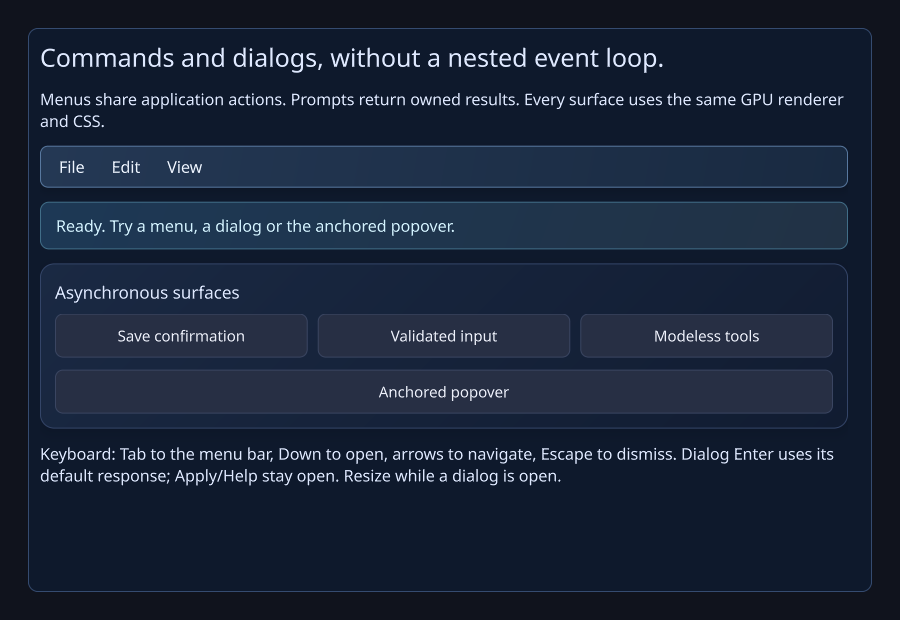
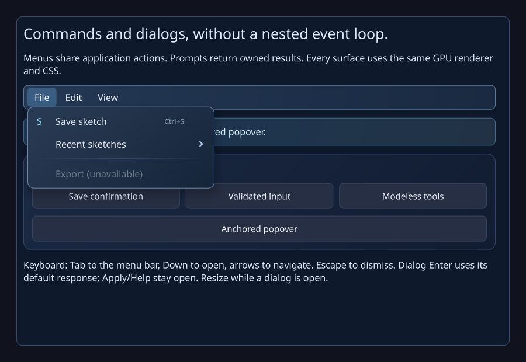

# Command/dialog batch verification (0.19)

Delivered: W24, W26, W27 and W28, with glyph icons and in-window dialog surfaces.
[COMMAND_DIALOGS.md](../COMMAND_DIALOGS.md) records ownership, keyboard behavior,
size/resource bounds and the remaining native-window/image/workspace scopes.
The compiled [public example](../examples/CommandDialogs.cpp) uses the delivered
API, and the interactive **Menus & dialogs** tab starts idle.

Local GNU 13 Release: **38/38** CTest suites pass, including **68** command/dialog
checks and real software-GL framebuffer integration (14.51 seconds total).
ASan/UBSan: **38/38**, including the GPU probe (86.06 seconds total; GPU 32.85).
No compiler warnings. Leak detection is disabled under host tracing; native
third-party libraries/Mesa are uninstrumented. Tested library code: `d1faaa8`;
Windows-only native fixture corrections: `6ee8e49` / `8111a55`.
Generated executable headers were checked; confirmed empty generated build
artifacts were rebuilt before accepting local test results.

Linux CI: **38/38** Release/software-GL suites and **6/6** isolated
ThreadSanitizer suites, with no compiler warnings.
Windows / MSVC 2022 / x64-windows-estudioui: **40/40 Release** and **40/40 Debug**
pass, with no compiler warnings. Two additional native Debug runs pass **95**
checks each; a third exposed an intermittent native file-picker startup-cancel
hang. Native cancellation is being hardened and reverified with five repeated
Debug probes. The widget, menu/dialog and collection assertions are preserved.
[CI run](https://github.com/jamedev/EStudioUI/actions/runs/39905320152).

CPU coverage includes anchored edge flips, live transform placement without
intrinsic remeasurement, explicit fixed-size preservation, weak anchor/owner
expiry, one session per presentation, callback deletion/errors, default/cancel
responses, editor validation, nested popovers, modeless workspace interaction,
Escape and focus, owned input results after reopening/removal, menu pointer and
keyboard navigation, disabled actions, submenu chains, persistent shortcut
association/rebinding and canonical semantic actions. Shared input/phase, font,
composition, collection and lifetime regressions remain enabled.

Actual renderer probes cover menus with glyph/shortcut/arrow content, rich
input/confirmation dialogs, interactive popovers, intermediate resize and light
style composition. Menu/popover retained pixels match full redraws exactly.
Static gallery and open menu frames have zero repaint pixels and no continuously
requested animation frames. Bounds and an actual visible anchor are checked.
Driver: Mesa llvmpipe software GL. This proves pixels and bounded work, not
hardware GPU utilization or 60 FPS. Captures are converted losslessly from the
actual C++ renderer's PPM output.

The actual full demo application was also rendered at 1280 x 800 in both themes,
with its real tab/header composition and a menu open. Its default command page
is visible and starts idle with zero repaint pixels.

NativePlatform adds Windows UI Automation menu-bar/expansion, dialog role/modal
availability, and input-value/acceptance probes. Independent command controls use
floating bounds to preserve the collection fixture's viewport budget and its
original cell-reveal assertion. The matching portable reproduction verifies a
394 x 32 logical-pixel revealed cell after the fixture correction.

Hosted Windows CI explicitly skips GPU; Build.ps1 defaults to a native GPU check
on developer machines. Human installed-language IME, Narrator and mixed-monitor
acceptance remain in [PLATFORM_ACCEPTANCE.md](PLATFORM_ACCEPTANCE.md).

Picker hardening defers Close until the initial folder-ready callback has
returned and attaches a cancellation timer to the actual dialog HWND. Native
acceptance diagnostics identify Show/Close/COM-release phases. CI separates
Release, Debug and repeated native steps so their results remain inspectable.
