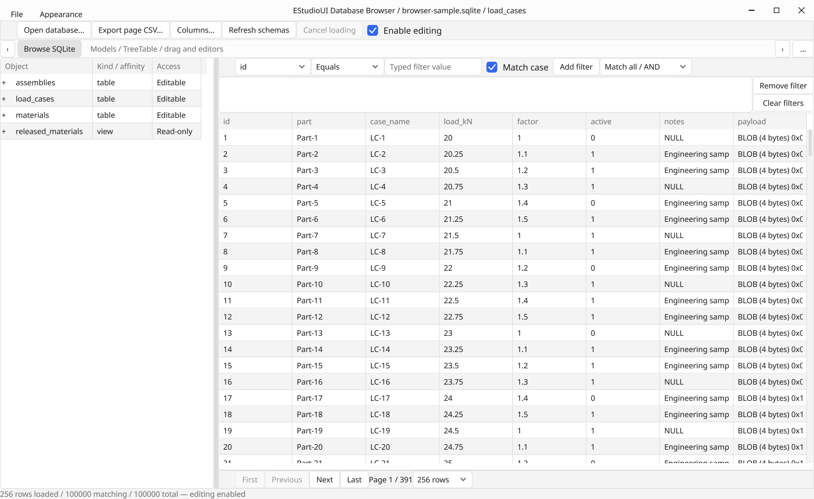
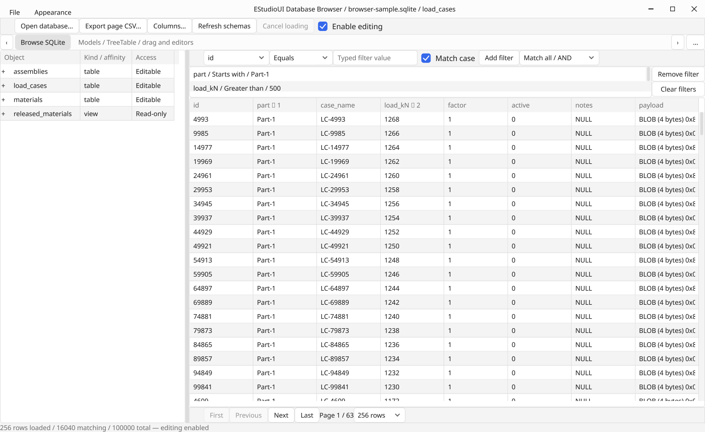
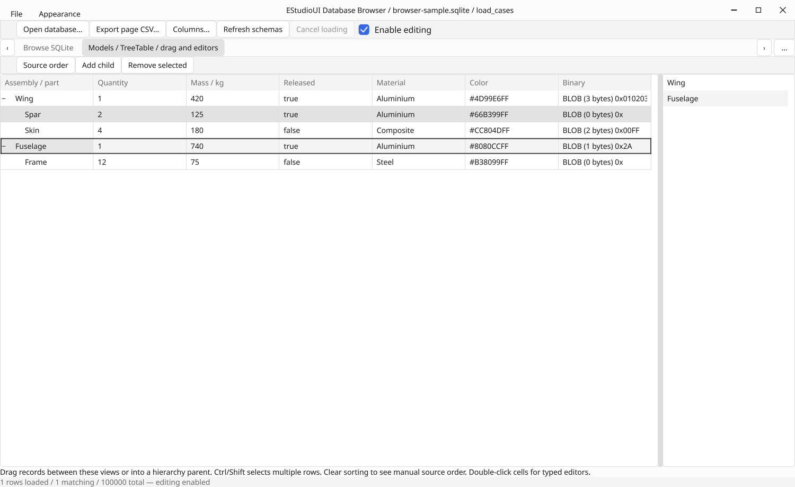
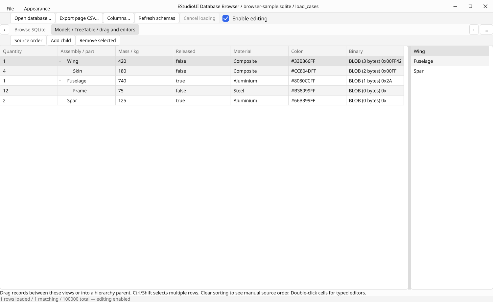
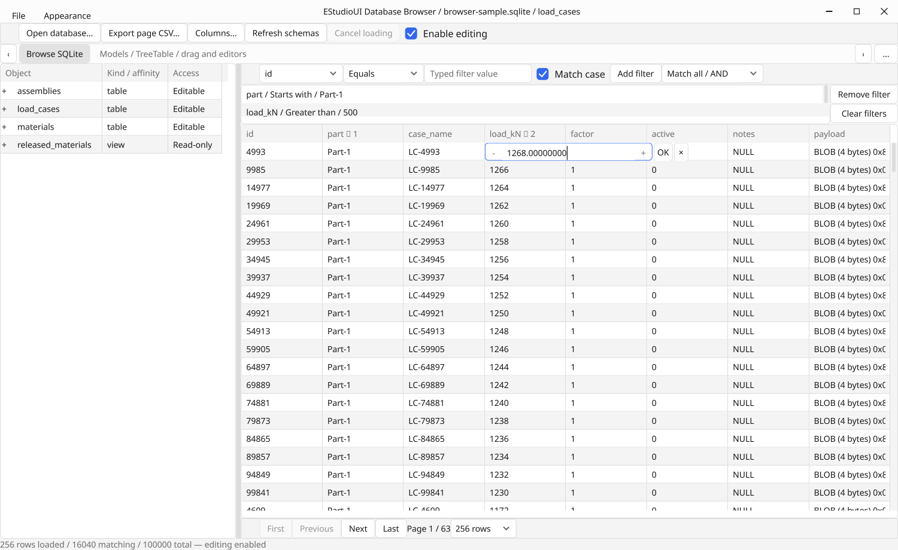
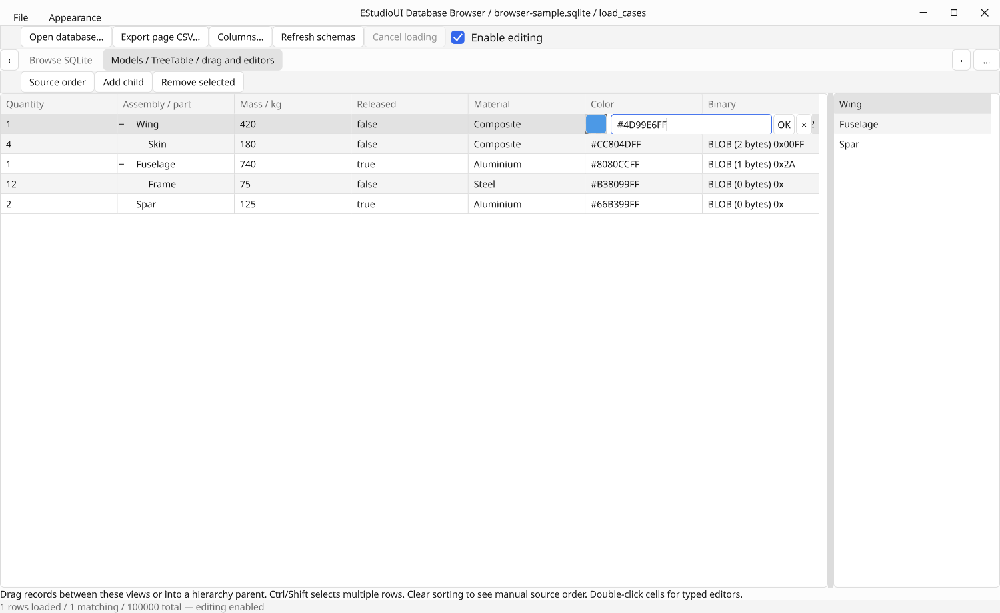

# Stronger data views, SQLite adapters and native caption ownership (0.25)

Source under verification: `5d304a8ecfdceca10d7a69d2cd89191f69164987`.
Date: 2026-10-24.
[Source CI run](https://github.com/jamedev/EStudioUI/actions/runs/40099945384).
The evidence-only follow-up commit does not change compiled inputs.

## Delivered behavior

- TreeTable reuses virtual table cells, expanded-branch prefixes, canonical
  selection and stable virtual semantics. Collapsing/revealing does not create
  descendant widgets. Columns support captured header reordering, visibility,
  resizing, presentation-aware keyboard navigation and accessible coordinates.
- Table/list/tree views share captured stable-ID row moves, forest normalization,
  revision/cycle validation, cross-view targets and CSS/GPU insertion previews.
  A structural drop is explicit O(n) work; ordinary painting remains viewport work.
- Typed cell compositions provide exact integers, numeric input, checkboxes,
  choices, colors, nullable text and hexadecimal binary. Pending edits retain a
  disabled draft until a confirmed result. Failures preserve its exact input. Extreme finite reals use exact scientific text, preserving
  values outside the spin control range even when accepted without changes.
- Worker-safe ModelAdapter providers feed bounded AdapterModel windows through
  the existing ItemModel/StateStore boundary. Status/counts/data/key maps are
  coherent. Results have reserved delivery under ordinary queue overload.
  Superseded reads and expired receivers cannot publish stale data.
- SQLite supports schema discovery, typed AND/OR filtering, literal text search,
  explicit collation/null ordering, multi-key sorting, paging, exact optimistic
  cell updates and atomic rollback. Keys include rowid and non-null composite
  WITHOUT ROWID keys; unaddressable views/tables are honestly read-only/unkeyed.
- The actual browser uses a 100,000-row engineering file, public views/adapters,
  explicit edit opt-in, typed filters, column management and page CSV export.
  Changing write access retains the active table/filter/sort/page.
- Custom Win32 chrome explicitly owns non-client rendering while retaining shell
  resize/maximize/system-menu styles. Desktop-pixel tests cover caption/title,
  active/inactive/theme updates as well as the existing native command/resize path.

## Acceptance results

Local final-source Release passes **54/54** suites (19.29 seconds), including the
actual demo, Creator, browser and rendering-profile integrations. Local final-source
ASan/UBSan passes **54/54** suites (76.24 seconds). The 512-model real-worker
retirement case also runs under sanitizers; worker completion retains a CPU-only
notification flag and never temporarily retains UI-owned State storage.

The final-source [CI run](https://github.com/jamedev/EStudioUI/actions/runs/40099945384)
completed successfully. All three jobs are green:

| Check | Result |
| --- | --- |
| Windows/MSVC Release, x64-windows-estudioui | 54/54 suites, 9.83 s |
| Windows/MSVC Debug, same triplet | 54/54 suites, 83.10 s |
| Native Win32/WGL software-GL integration | Demo, Creator and database browser passed |
| Native database browser | 308 checks (283 application checks plus 25 native caption checks) |
| Native Creator | 70 checks |
| Isolated Win32 caption regression | 51 checks; six SC_SIZE scheduler ticks |
| Early MSVC compilation | 18 public model/view/application sources passed without third-party headers |
| Extra native Debug lifecycle runs | Five runs, 103 checks each |
| Linux/OSMesa CI | 54/54 suites, 32.20 s |
| Isolated CPU ThreadSanitizer | 6/6 suites, 3.21 s |
| Local ASan/UBSan | 54/54 suites, 76.24 s |

PowerShell 7 parsing and actual Windows PowerShell 5.1 Release/Debug orchestration
passed. Build.ps1 checks all expected applications and the new browser GPU stage;
CI's explicit -SkipGpuTest build steps are followed by a separate native software-GL
stage. No C++ compiler warnings were observed in the final CI logs. The pinned
libunibreak port still emits its existing CMake author warnings about PARENT_SCOPE.

The new local CPU suites report 38 adapter-model checks, 38 data-view checks and
32 SQLite checks. The actual Linux/OSMesa browser reports 283 checks. Its native
Win32/WGL run additionally invokes the shared native caption probe.

The isolated native Win32 probe passes 51 checks, including a desktop DC pixel
sample above the GPU caption after title and theme changes, with at least five
ordinary scheduler ticks during a real SC_SIZE loop. This checks compositor output,
not only client-rectangle math. The earlier native probe did not detect the DWM
caption overlay, because it only checked client geometry.

The browser's retained and forced-full framebuffers are byte-identical both during
a captured drop preview and after ordinary view/editor interaction. Its query
checks evaluate actual returned records from the complete filtered source; they
do not replace database values with demo-only widget data.

Release core/renderer checks, ASan/UBSan, isolated CPU TSan and real native Windows
checks have different scopes. Software GL demonstrates rendering correctness;
it does not establish physical GPU throughput or a 60 FPS hardware guarantee.
ASan uses `detect_leaks=0` for the software GL environment; this is not leak-detector
coverage. Isolated TSan exercises the CPU concurrency sources, not the entire GL/UI
or SQLite adapter stack.

## Actual renderer captures

All PNGs below are lossless conversions of PPMs emitted by EStudioUIDatabaseBrowser
from the source above. No hand-built mockup, browser-rendered substitute or image
compositing was used.

## Explicit scope and limits

AdapterPage is a flat loaded window, not a full database-sized virtual snapshot.
Canonical selection is scoped to loaded records; source keys and the bounded ID
cache are distinct from persistent cross-database selection. Lazy per-branch
hierarchical provider fetching is separate work; the hierarchy playground binds
an ordinary hierarchical ItemModel directly. SQLite uses exact counts and
LIMIT/OFFSET, so unindexed queries and deep offsets can still scan source data.

Default SQLite cell/page budgets are 1/8 MiB. The bridge bounds published raw data,
keys and display text independently; it never silently truncates canonical source
fields. Inline large-document editing remains F10b. Custom providers must be
worker-safe and cooperate with cancellation; forced owner retirement can lose a
race with a database transaction that has already committed. Confirmed terminal
outcomes distinguish persistence from a merely queued request.

OS/cross-window record dragging, automatic drag-edge scrolling, persistent physical
SQL ordering, structural SQL writes, a SQL console/schema editor/importer, global
selection, F10b document editing and F14 SDK/module packaging are not delivered here.
Windows 11 flyouts, physical mixed-DPI monitors, shadow/corner fidelity and real
assistive-technology interactions remain the existing human platform acceptance
work. The passing automated caption test establishes the regression it exercises.

API/resource/lifetime contracts: [DATA_VIEWS.md](../DATA_VIEWS.md).
Application usage: [SQLITE_BROWSER.md](../SQLITE_BROWSER.md).
