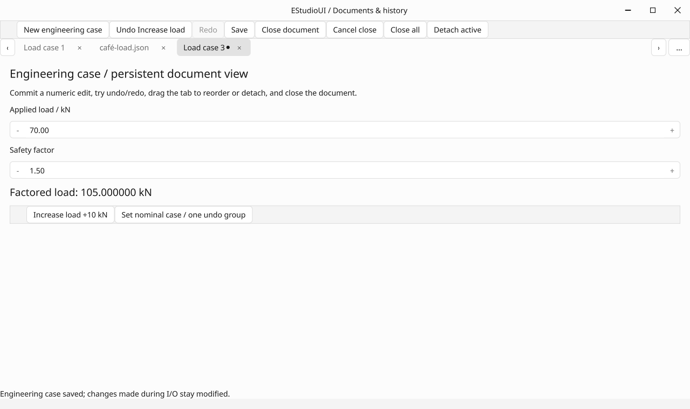

# Document workspace and undo history (0.24)

This increment implements W22 and the document lifecycle/history slice of F16.
The [public contracts](../DOCUMENT_WORKSPACE.md) distinguish this delivery from
versioned application-session restore, recovery, F10b and F14 modular extraction.

## Local evidence

- GCC 13 Release: all **50/50** CTest suites pass (13.83 seconds for the final local run).
- `UndoHistory`: **51 checks**, covering canonical transaction/group rollback,
  final validation, reverse command order, observer failures, receiver/domain
  expiry, reentrancy, branching/pruning, count/byte budgets and saved checkpoints.
- `DocumentWorkspace`: **45 checks**, covering real popup decisions, close-all
  preflight, save failure/cancellation, edits during save, focused-editor commit,
  stable close targets, hidden ancestor navigation, late tab-menu connections,
  saturated ordinary queue delivery, eight concurrent ticket completions,
  recursive service rejection and owner teardown.
- Main gallery: **25 actual-renderer/persistence checks**, including real pointer
  close/reorder/drag-out, native host creation, persistent editor identity,
  detached framebuffer pixels, detach/reattach, stale-save approval, production
  GLFW close callback veto and approved native shutdown.
- Creator's existing renderer/catalog acceptance passes with the migrated history.
- Retained and forced-full document framebuffer RGB bytes are identical.
- MinGW C++20 Windows syntax checks pass without warnings for the new native
  gallery, workspace, save/close sessions, history and Window implementation.
- Nine of those 25 checks run the actual gallery file workflow: canonical model
  edits, real worker JSON writes to a Unicode filename, UTF-8 tab captions,
  older disk saves preserving newer edits, atomic overwrite and its clean point,
  independent document creation, scripted picker cancellation, actual filesystem
  failure preserving every view, and no leftover replacement temporary file.
  Only the picker result is injected through MemoryPlatformServices; application
  callbacks, worker writes and error delivery are production code.
- GCC 13 AddressSanitizer + UndefinedBehaviorSanitizer: **50/50** suites pass on
  final source (131.69 seconds, including actual GPU/persistence checks). Leak
  detection is disabled for the software GL process; address/undefined-behavior
  failures are fatal. Both final builds and MinGW checks emit no warnings.
- No new runtime dependency, idle timer or worker-thread rendering is introduced.

All captures below are lossless conversions of actual C++ OpenGL framebuffer
output. The green block is a controlled pixel probe in the test document.
Linux software OpenGL validates correctness, not hardware throughput. Final
source is [`33c2e0d`](https://github.com/jamedev/EStudioUI/commit/33c2e0dd7795b112e03b91bf5fb1e6c4636ead33).
The [CI run](https://github.com/jamedev/EStudioUI/actions/runs/40085389777)
completed successfully on that exact source commit. Its source checks report no
MSVC compiler/linker warnings.

## Native and CI evidence

| Gate | Result |
| --- | --- |
| Windows MSVC 2022 Release | **51/51** suites passed |
| Windows MSVC 2022 Debug | **51/51** suites passed |
| Native Windows/WGL + Mesa gallery | **25 document workflow/persistence checks** passed, alongside the complete gallery and rendering smoke |
| Native Windows/WGL Creator | **69 checks** passed with the shared history service |
| Repeated native Debug lifecycle | **5 × 103 checks** passed |
| Isolated Win32 title chrome | **47 checks** passed, including native resize-loop ticks |
| Linux CI core/framebuffer | **50/50** suites passed |
| Linux CI isolated CPU ThreadSanitizer | **6/6** suites passed |

The Windows persistence fixture creates real owned native windows and uses the
actual file worker and atomic replacement API, including its Unicode caption.
Its picker result is injected; the full platform suite separately exercises the
native service lifecycle. Native framebuffer output here uses Mesa software GL.

Physical drag/snap behavior, real user file-picker interactions and mixed-monitor
DPI remain interactive acceptance; this report makes no hardware FPS claim.

## Captures

| Capture | Pixels | RGB SHA-256 |
| --- | --- | --- |
| documents-gallery.png | 1280 × 760 | `a28c60f8b1dea56cf7fe42050765388ad86e579f977fcd9623dcc5a3f4e08e61` |
| documents-workspace.png | 1180 × 800 | `a4707f7c5c27477c3ff6b1c8bab6414fd3ff628c40fad1867365640548dade97` |
| documents-save-discard-cancel.png | 1180 × 800 | `8e44730415573b45c8574c170a721c5e714f1224b49cdee1d50652c5c844663c` |
| documents-detached.png | 900 × 650 | `76161a9c27a177461a5b14b830afd16177a6a5a0999c7008beecab6bcaafa9d8` |
| documents-reattached.png | 1180 × 800 | `07d7718eaeccb7d2ff2ef27a823b8ea08083989b0ccb999327080f14acb4c377` |
