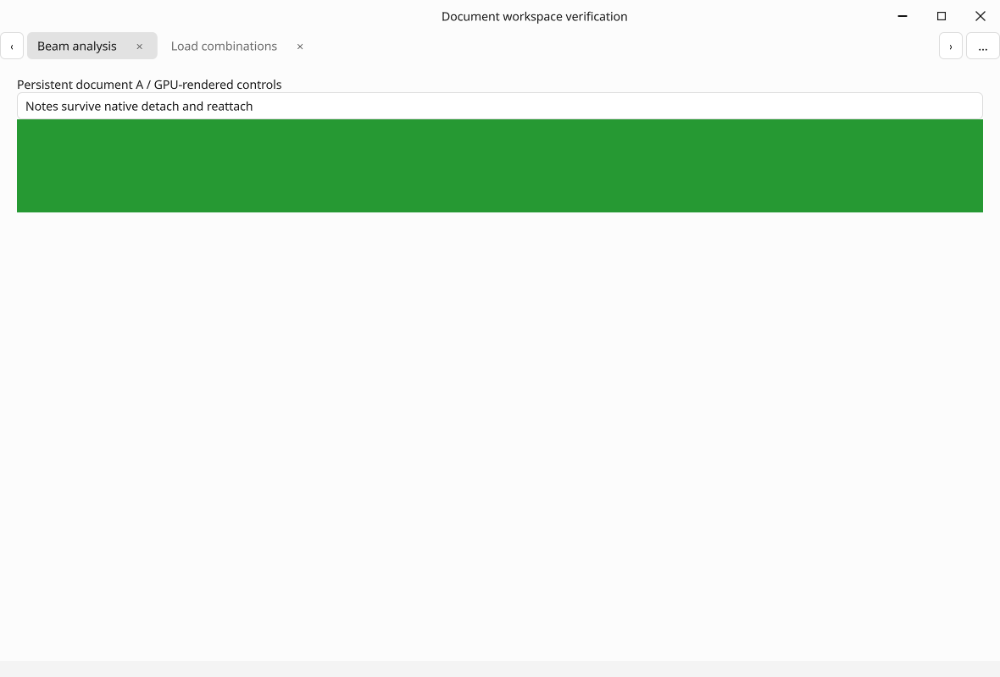
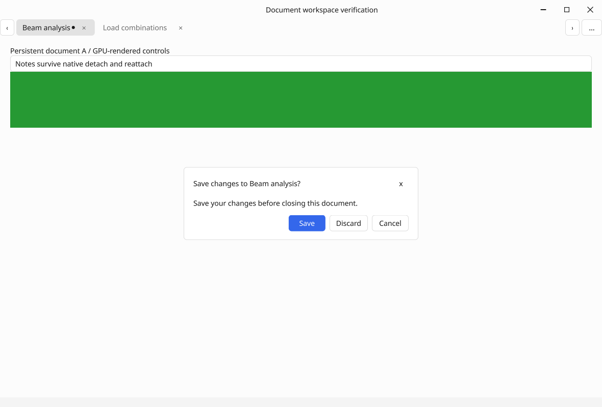
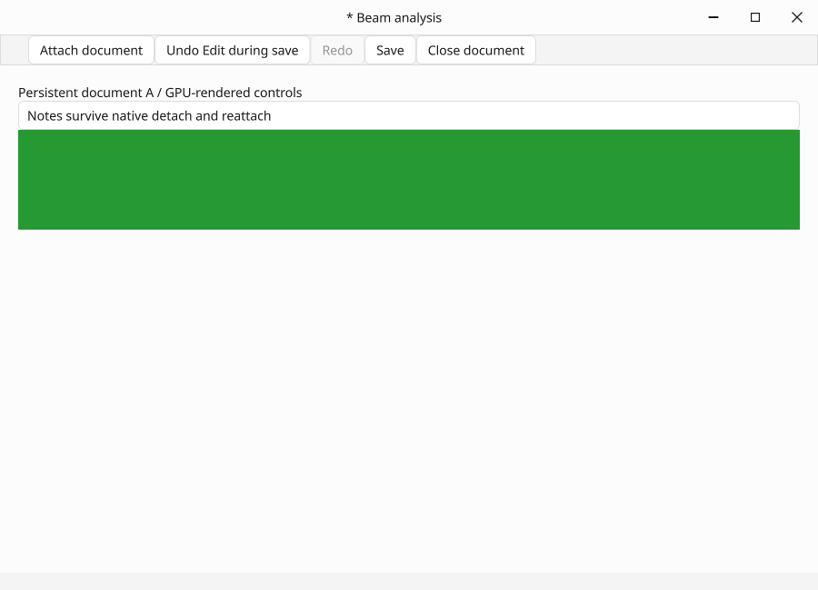

# Document workspace and undo history (0.24)

This increment implements W22 and the document lifecycle/history slice of F16.
The [public contracts](../DOCUMENT_WORKSPACE.md) distinguish this delivery from
versioned application-session restore, recovery, F10b and F14 modular extraction.

## Local evidence

- GCC 13 Release: all **50/50** CTest suites pass (12.51 seconds for the final local run).
- `UndoHistory`: **51 checks**, covering canonical transaction/group rollback,
  final validation, reverse command order, observer failures, receiver/domain
  expiry, reentrancy, branching/pruning, count/byte budgets and saved checkpoints.
- `DocumentWorkspace`: **45 checks**, covering real popup decisions, close-all
  preflight, save failure/cancellation, edits during save, focused-editor commit,
  stable close targets, hidden ancestor navigation, late tab-menu connections,
  saturated ordinary queue delivery, eight concurrent ticket completions,
  recursive service rejection and owner teardown.
- Main gallery: **16 additional actual-renderer checks**, including real pointer
  close/reorder/drag-out, native host creation, persistent editor identity,
  detached framebuffer pixels, detach/reattach, stale-save approval, production
  GLFW close callback veto and approved native shutdown.
- Creator's existing renderer/catalog acceptance passes with the migrated history.
- Retained and forced-full document framebuffer RGB bytes are identical.
- MinGW C++20 Windows syntax checks pass without warnings for the new native
  gallery, workspace, save/close sessions, history and Window implementation.
- No new runtime dependency, idle timer or worker-thread rendering is introduced.

All captures below are lossless conversions of actual C++ OpenGL framebuffer
output. The green block is a controlled pixel probe in the test document.
Linux software OpenGL validates correctness, not hardware throughput. Native
Windows MSVC/WGL acceptance and sanitizer results are recorded after CI completes.
Physical drag/snap behavior, real user file-picker interactions and mixed-monitor
DPI remain interactive acceptance; this report makes no hardware FPS claim.

## Captures

| Capture | Pixels | RGB SHA-256 |
| --- | --- | --- |
| documents-workspace.png | 1180 × 800 | `a4707f7c5c27477c3ff6b1c8bab6414fd3ff628c40fad1867365640548dade97` |
| documents-save-discard-cancel.png | 1180 × 800 | `8e44730415573b45c8574c170a721c5e714f1224b49cdee1d50652c5c844663c` |
| documents-detached.png | 900 × 650 | `76161a9c27a177461a5b14b830afd16177a6a5a0999c7008beecab6bcaafa9d8` |
| documents-reattached.png | 1180 × 800 | `07d7718eaeccb7d2ff2ef27a823b8ea08083989b0ccb999327080f14acb4c377` |
