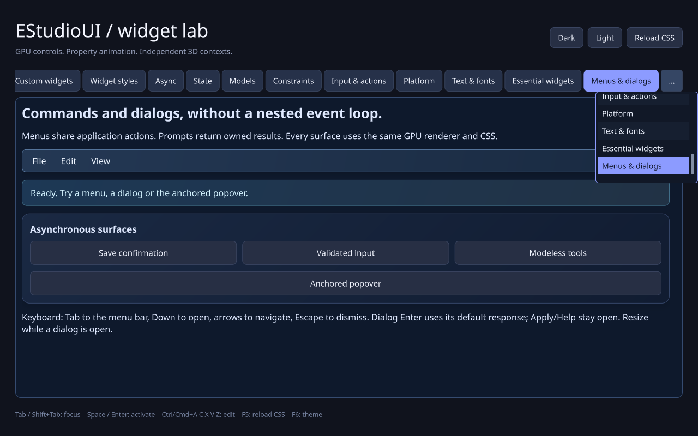
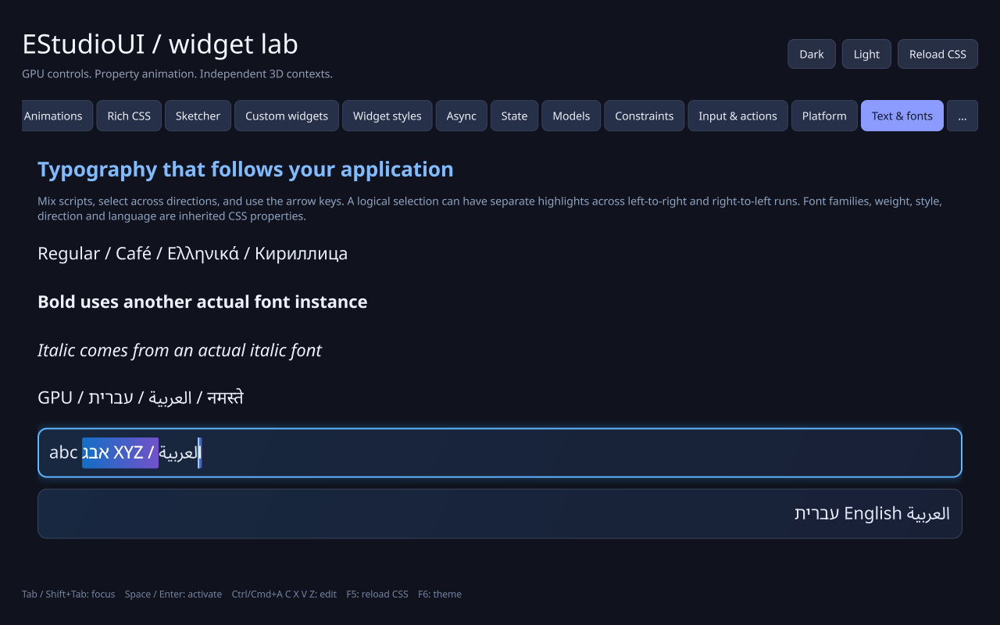
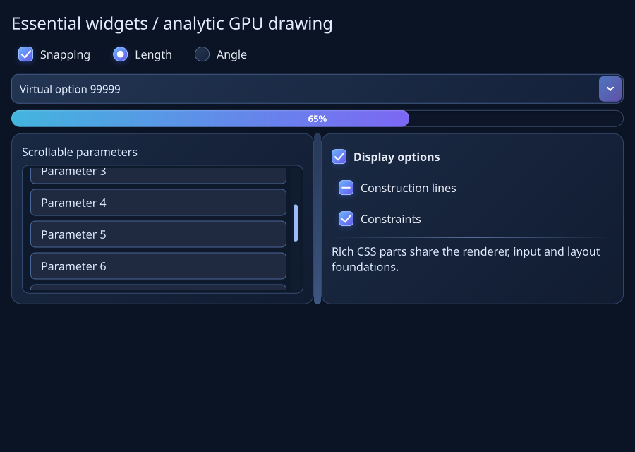

# Interaction and native framebuffer follow-up (0.19)

This follow-up addresses Jose's Windows report of 40 passing core suites followed
by a failing native GPU self-test, mixed-direction drag jumps, a ScrollArea thumb
that did not drag, an overflowing gallery tab strip and duplicated header shortcuts.

## Confirmed causes and corrections

- ScrollArea inherited wheel handling and scrollbar drawing but no pointer-down
  handler. Collection controls supplied their own adapter, and StyledScroll used
  a test subclass with that adapter. ScrollWidget now supplies the production
  default; tests drag an actual ScrollArea, release outside it and cancel through
  window deactivation. The child form moves without intrinsic remeasurement.
- TextLayout picked an arbitrary caret among coincident visual bidi boundaries.
  Near-edge grapheme hit tests failed before the correction. Hit testing now uses
  the pointed grapheme's edge and affinity, with existing sorted indices and no
  per-move shaping/allocation. Captured drag checks preserve the anchor and exact
  logical selected bytes. Disjoint highlights across bidi runs remain correct.
- TabWidget had an unbounded horizontal row. The natural-width strip now clips
  around the selected/focused tab. An always reachable `...` button opens a bounded
  virtual ListWidget popup with every page. Existing popup ownership, keyboard,
  accessibility and CSS ancestry are reused. Snapshot rows resolve through weak
  persistent page identities if earlier tabs are removed while it is open.
- The gallery added Platform services and Menus & dialogs shortcuts beside the
  theme buttons even though those pages already had selectors. Both shortcuts
  are removed; the header has only Dark, Light and Reload CSS.
- The generic missing-stylesheets warning was generated by an intentional
  negative reload test. That expected check is quiet; genuine read failures list
  the exact missing paths and still retain the preceding theme atomically.

## Verification gap and follow-up

The previous Windows CI ran core/native CPU suites with `-SkipGpuTest`.
Framebuffer checks ran on Linux OSMesa. The previous verification therefore did
not exercise Windows rendering. Passing the core/native CPU tests was insufficient
for native callback and interaction gates; those missing checks are now added.

CI now stages a pinned, SHA-256-verified Mesa 26.2.4 runtime beside a temporary
demo copy and executes the same native `--self-test` command using real Win32/WGL
windows. It does not replace system drivers or add a distributed dependency.
The first run exposed an earlier native resize assertion before reaching the
reported drop assertion. Its diagnostic confirmed that the runner's desktop
clamped a requested 1320 x 900 client to 1028 x 749 at scale 1. The native resize
fixtures now explicitly permit an 8192-pixel maximum track size, so exact resize
and 1x/2x framebuffer assertions remain enabled on small desktops. Ordinary
application windows keep their defaults. Framebuffer assertions also include
the monitor's actual DPI scale instead of assuming it is 1.

The drop fixture is positioned in the visible desktop, settles native focus/size
events and verifies its actual cursor position before invoking the production
callback. A state batch now forces deferred input: the source path is overwritten
and destroyed before queued delivery, testing ownership rather than only an
immediately consumed callback.

At `fe7e1a4`, Linux CI passes Release/software GL and isolated ThreadSanitizer,
and Windows core suites pass 40/40. The new Windows framebuffer gate correctly
fails at the desktop clamp described above. Those failures were investigated
and corrected without disabling their assertions.

Final local checks at `6b0106e`:

| Configuration | Result | Elapsed |
| --- | --- | --- |
| GNU 13 Release, including actual GL framebuffer integration | 38/38 passed | 12.29 s |
| GNU 13 ASan/UBSan, including actual GL framebuffer integration | 38/38 passed | 92.66 s |

The sanitizer GL probe takes 35.21 seconds. The suites include 368 font/text
checks and 78 essential-control checks. Generated executable/object ELF headers
were verified before accepting results; one confirmed empty host-generated
SemanticTree object was rebuilt. No compiler warnings or sanitizer reports.
Leak detection is disabled under host tracing; Mesa and native third-party
libraries are uninstrumented. An independent read-only review found no required
fixes in chooser lifetimes, persistent page identity, pointer affinity, capture
routing or the native test fixtures.

Windows CI at `6b0106e` passes in
[run 39919364418](https://github.com/jamedev/EStudioUI/actions/runs/39919364418):

| Check | Result |
| --- | --- |
| MSVC 2022 Release | 40/40 passed, 8.82 s |
| MSVC 2022 Debug | 40/40 passed, 116.43 s |
| Native Win32/WGL complete framebuffer self-test | GPU integration PASS, Mesa 26.2.4 llvmpipe |
| Additional native Debug lifecycle repetitions | 5 passes, 95 checks each |

No MSVC compiler/linker warnings. The formerly failing production drop assertion
is part of the passing complete native self-test. The first Linux attempt at
this commit failed before compilation because the vcpkg bootstrap download
returned HTTP 500; only the failed Linux job was retried.

The Linux retry at the same commit passes Release/software GL 38/38 in 13.26
seconds and isolated CPU ThreadSanitizer 6/6 in 1.83 seconds. No compiler
warnings or sanitizer reports. The complete workflow's second attempt is green.

Software rendering proves pixels and work bounds, not hardware utilization or
60 FPS. Human IME/AT/mixed-monitor acceptance stays in PLATFORM_ACCEPTANCE.md.

Captures below come from the actual C++ demo/renderer, converted losslessly from
PPM. The text image is a captured pointer drag with anchor byte 4 and caret byte
19; the second highlight is a legitimate part of the same logical bidi range.

