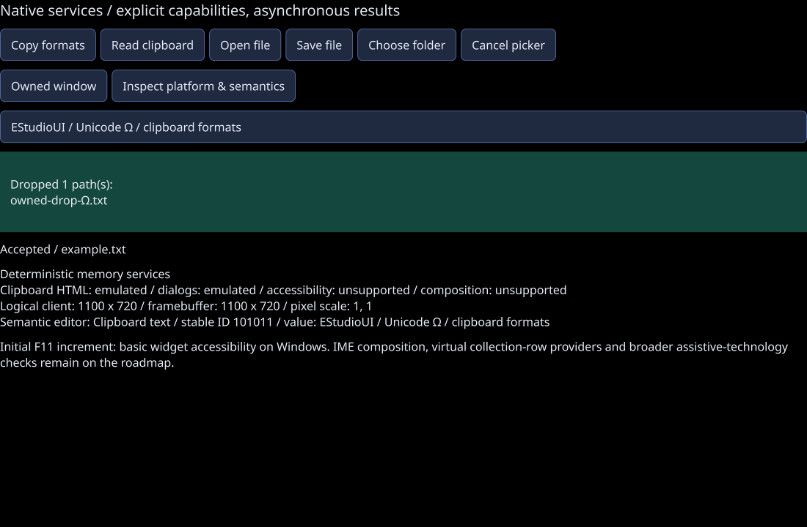

# Initial F11 platform and semantic services / 0.15 verification

Recorded 2026-10-22. This is an initial working F11 increment, not completion of
F11 or Gate B. API contracts, capability distinctions and remaining scope are in
[PLATFORM.md](../PLATFORM.md).

## Local evidence

| Check | Observed result |
| --- | --- |
| GCC 13 Release, Linux | 34/34 suites, including actual GPU renderer integration |
| AddressSanitizer + UndefinedBehaviorSanitizer | 34/34 suites, including renderer, platform/semantic fixtures and native-resource retirement |
| Isolated CPU ThreadSanitizer | 6/6 suites; the expanded owning input boundary is compiled with the shared command/runtime tests |
| Platform contract fixture | 54 checks: UTF-8/formats/aggregate budgets/case-insensitive identity, coordinates, asynchronous sessions, cancellation, observer errors, queue overload, owner/queue closure, adapter replacement and native host failures |
| Semantic fixture | 31 checks: roles/names/values/actions, focus, custom hooks, safe deletion/identity, popup hierarchy/modal barriers, query purity guards and DPI desktop bounds |
| Actual platform gallery | Injected rich clipboard and picker update a live GPU caption; production GLFW drop callback copies UTF-8 path storage; actual green drop-area pixels checked |
| Semantic query work | 50 actual-widget queries cause zero style resolution or layout recalculation |
| Native resource retirement fixture | Deleted C++ Window retains its native adapter while simulated native work is active, then releases it on a safe owner turn after unwind |
| Production pointer callback fixture | Native-coordinate inputs scale into logical UI positions; the actual GPU probe passes in Release and ASan/UBSan after the fixture update |
| Owned window fixture | Closing a parent closes a separately owned secondary Window while its C++ owner remains alive |

Raw results: [Release suites](platform-release-tests.txt),
[gallery report](platform-gpu-report.txt), [ASan/UBSan suites](platform-sanitizer-tests.txt),
[ThreadSanitizer suites](platform-thread-tests.txt),
[DPI callback/GPU recheck](platform-dpi-tests.txt),
[instrumented DPI callback/GPU recheck](platform-dpi-sanitizer-tests.txt). Leak detection is disabled
under the host process-tracing restriction; third-party GL/dependency code is not
instrumented. These checks do not establish leak freedom.
The actual C++ renderer capture below
uses GLFW's null platform and OSMesa/llvmpipe, then lossless PNG conversion; it is
not a native OS picker screenshot or hardware GPU benchmark.

## Native Windows and sanitizer acceptance

The Windows pipeline compiles and tests Release/Debug through the existing
Build.ps1 x64-windows-estudioui flow. The new NativePlatform executable uses a
real Windows HWND and a real UI Automation client on an MTA thread. It reads
actual semantic names and Invoke/Value/RangeValue/Toggle patterns, verifies
canonical widget updates and rejects fresh retained-provider edits after closure.
Cached client values are owned snapshots and do not establish live provider access.
The UI owner pumps its ordinary messages and owning dispatcher throughout.

Windows CI sets ESTUDIOUI_NATIVE_PLATFORM_TESTS=1. This additionally publishes
and reads actual CF_UNICODETEXT, HTML, CF_HDROP and custom binary formats,
checks immediate Busy on another thread's clipboard lock, rejects malformed
external HTML and combined format budgets, tolerates prior mixed-case format
registration, shows each real Open/Save/Folder picker before cancelling it,
and retains a replaced adapter until its STA unwinds. These are real native
integrations; the ordinary developer test run omits the clipboard-changing and
visible-picker sections unless explicitly opted in.

The follow-up diagnostic run at `2648c9af82e397c76e3a4b00d26a4e742a0ce378`
([CI 39855143350](https://github.com/jamedev/EStudioUI/actions/runs/39855143350))
completed the UI Automation and clipboard stages, and cancelled the Open and Save
pickers, then timed out during Folder cancellation. It therefore did not pass the
complete native suite. The cancellation fix and final 0.16 results are recorded
in [PLATFORM_0_16.md](PLATFORM_0_16.md); this historical result stays unchanged.

## Remaining acceptance work

- The 0.16 implementation adds composition/caret geometry and virtual collection
  patterns; see [its evidence and limits](PLATFORM_0_16.md). Full font fallback and
  complete script/direction behavior remain F10a work.
- Real Narrator and other assistive-technology sessions for representative apps.
- Native multi-monitor DPI migration, desktop focus/ownership scenarios and
  developer-PC Windows GPU checks through normal Build.ps1.
- Outgoing drag sources and richer native drop payloads; broader platform
  implementations and hardware performance evidence under F15.

There is no per-frame full semantic-tree rebuild, no per-collection-row widget
expansion and no new third-party runtime dependency. A Windows accessibility
capability reports an attached initial native bridge, not complete application
or screen-reader readiness.
