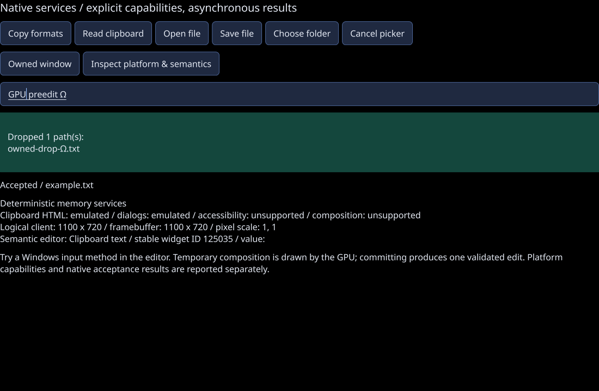

# F11 composition and virtual accessibility / 0.16

Recorded 2026-10-22. This increment extends the 0.15 native-service baseline with
the shared text-composition protocol, GPU preedit presentation, Windows IMM input,
virtual collection/canvas semantics and additional Windows UI Automation patterns.
Public contracts and explicit budgets are in [PLATFORM.md](../PLATFORM.md).

## Verification status

Source `12a482b66222852f0b5a9fb7a707bede87eb3db8` passes local Release,
ASan/UBSan and native Windows verification.
[CI 39863506352](https://github.com/jamedev/EStudioUI/actions/runs/39863506352)
passes both Windows and Linux jobs at that exact source revision.

| Check | Status |
| --- | --- |
| GCC 13 Release and actual renderer integration | 35/35 suites passed; final rebuild has no compiler warnings |
| Semantic fixture | 190 checks passed, including 100,000-row bounded queries, focus-callback dataset replacement and targeted event revisions |
| Portable text input | 47 checks passed, including cancellation-hook deletion, borrowed-input ownership, focus redirection and reentrancy |
| AddressSanitizer + UndefinedBehaviorSanitizer | 35/35 suites passed, including actual framebuffer and callback-deletion regressions |
| Windows MSVC Release and Debug | 37/37 suites passed in each configuration through Build.ps1; no warning lines in the Windows job log |
| Repeated native cancellation/COM teardown | Three additional Debug executions passed 80 checks each; Open/Save/Folder, startup cancellation and adapter retirement all completed |
| Real UI Automation collection/text/event clients | Passed in Release, Debug and all three repetitions: virtual list/tree/grid, Text/Text2, events and retained-provider expiry |
| Actual HWND/IMM protocol probe | Passed in Release and Debug with injected native messages |
| Isolated CPU ThreadSanitizer | 6/6 suites passed in the Linux CI job; that job also passed all 35 Release/renderer suites |
| Interactive installed-language IME conversion | Not tested in this host |
| Narrator / other assistive technology | Not tested in this host |
| Physical mixed-monitor DPI migration | Not tested in this host |

## Regression scope

Raw results: [Release](platform-0-16-release-tests.txt),
[ASan/UBSan](platform-0-16-sanitizer-tests.txt),
[Windows Release/Debug and native repetitions](platform-0-16-windows-tests.txt),
[actual renderer report](platform-0-16-gpu-report.txt). Leak detection is disabled
under this host's process-tracing restriction. Third-party dependencies and Mesa
are not instrumented; these checks do not establish leak freedom or native driver
behavior.

The capture is the actual C++ framebuffer, losslessly converted from PPM. It uses
GLFW's null platform and OSMesa/llvmpipe; the displayed composition is injected
through the shared protocol, rather than a screenshot of an installed Windows IME.

- Temporary preedit does not mutate committed text, selection, validation or undo
  history. Commit is one canonical validated edit. Cancel/focus loss/programmatic
  replacement/owner closure expire the old session. UTF-8/UTF-16 boundaries,
  read-only controls, custom-client purity and bounded payloads are exercised.
- The actual C++ renderer checks that preedit changes pixels, cancellation
  restores the editor, and one undo reverses a commit. Virtual list/table reveal,
  hit testing, selection and editing are compared with actual geometry and pixels.
- A 100,000-row computed model records bounded item accesses for sampled semantic
  queries, without per-row widgets or style/layout work. Stable item identities
  survive sorting/filtering/moving; deletion, dataset replacement and owner death
  expire retained IDs. Tree, table, tab and canvas paths share canonical actions.
- Real Windows UI Automation probes exercise control actions, virtual selection,
  realization, tree expansion, grid cells, single-line text ranges, Unicode
  navigation and retained-provider expiry. Native provider methods marshal to
  the UI owner; clients do not read widgets on worker threads.
- The native input probe uses real HWND and IMM APIs with injected Win32 messages.
  It proves protocol/lifetime behavior, not a human language conversion session
  or the visual behavior of every installed Windows input method.

## Native picker timeout investigation

The 0.15 verification had a Windows Debug native-test timeout. A diagnostic run at
`2648c9af82e397c76e3a4b00d26a4e742a0ce378`
([CI 39855143350](https://github.com/jamedev/EStudioUI/actions/runs/39855143350))
also reproduced a Release timeout. Its flushed stages show that UI Automation
actions, provider closure, COM client teardown, clipboard checks, and open/save
picker cancellation completed. The last stage was folder-picker cancellation.

Cancellation now remains armed on the picker STA until Show returns, including
initialization callbacks and timer retries. This addresses a cancellation request
arriving before the shell is ready to close; that timing explanation is an
inference from the code and stage trace. The diagnostic follow-up at
`177cac3b13d037b652c946bf6494f349069b0ea8`
([CI 39862018623](https://github.com/jamedev/EStudioUI/actions/runs/39862018623))
completed Open/Save/Folder cancellation, cancellation during startup and adapter
retirement, with the complete native scenario finishing in 1.89 seconds. Its
remaining failure was an independent UI Automation test precondition described
below. The final 12a482 CI run then passed the complete native suite in Release
(1.81 seconds), Debug (1.53 seconds) and all three additional Debug repetitions.
Tests use a known local initial folder and report a failed assertion before
waiting for native cleanup. These times describe the hosted test scenario, not
UI frame rate or native dialog latency on arbitrary machines.

## UI Automation selection probe

The same diagnostic run completed real native collection/text/event and retained
provider checks. Its strict occupied-single-selection assertion failed because
the UI Automation client automatically focused the target before AddToSelection
(the documented [AutoSetFocus](https://learn.microsoft.com/en-us/windows/win32/api/uiautomationclient/nf-uiautomationclient-iuiautomation2-get_autosetfocus)
behavior).
Our list selects the focused row, so the provider then correctly saw an already
selected item and returned success. Full runtime IDs and an owner-side canonical
selection snapshot ruled out row identity collisions and stale client values.

The probe now exercises default automatic focus separately, then disables the
client's AutoSetFocus while testing the selection pattern alone. It requires an
empty selection after removal, verifies the first row is the sole selection,
requires `UIA_E_INVALIDOPERATION` when adding a different row, and verifies the
original selection stays unchanged. All three final Debug traces show the exact
HRESULT `0x80131509`, canonical current index 0, and the first row still selected.
Provider selection policy is unchanged.

## Acceptance boundary

The implementation and automated native checks are complete. Interactive
input-method, assistive-technology and physical monitor acceptance remains open.

Follow [native acceptance](PLATFORM_ACCEPTANCE.md) for interactive IME, Narrator,
multiwindow focus and physical mixed-DPI observations. A direct UI Automation
client is a real native integration test, but it is not a screen-reader session.
Software OpenGL/sanitizers do not establish native driver speed or hardware FPS.

F10a font resolution/fallback and complete script/direction shaping remain next.
F10b document storage/editing, outgoing drag sources, additional platform adapters,
and broader F15 hardware evidence retain their separate scopes. Canvas semantics
identify top-level persistent scene items; immutable geometry inside a group is
part of that independently selectable group, rather than a new persistent item.
