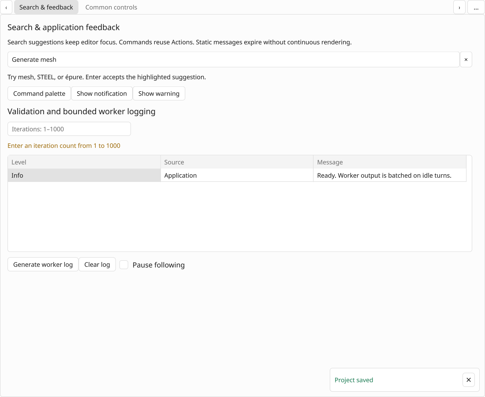
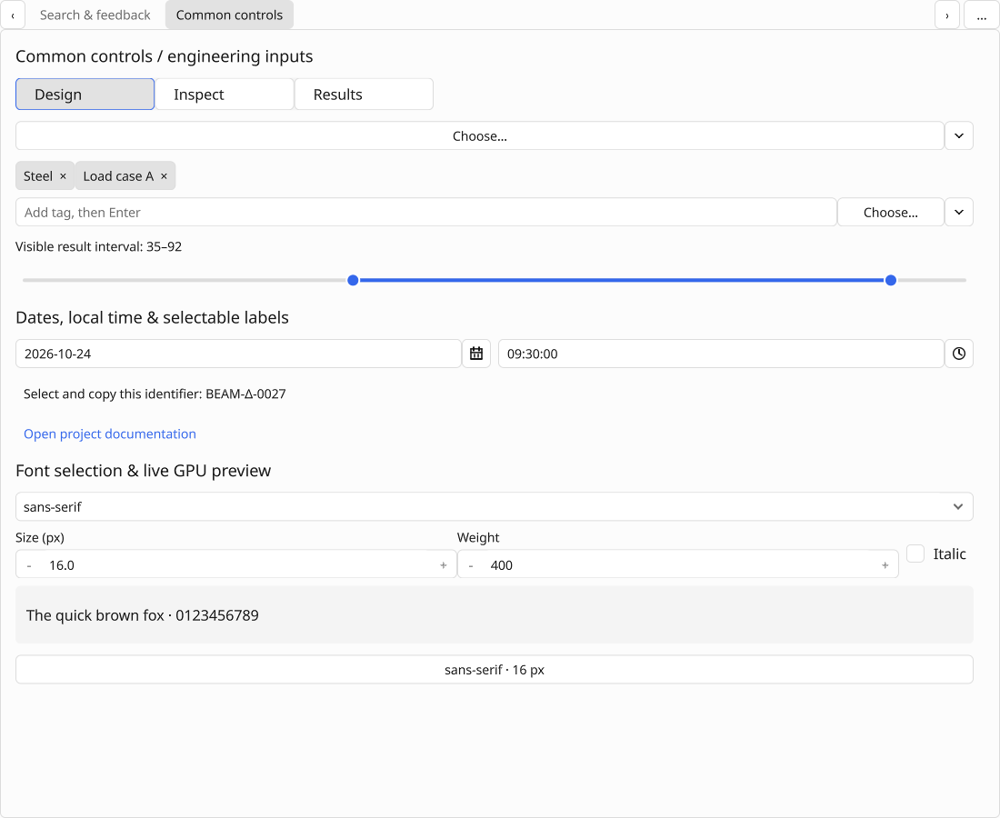
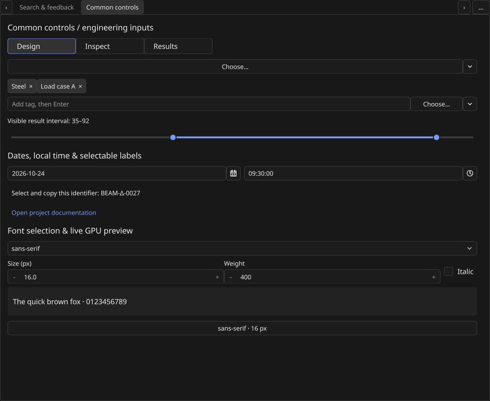
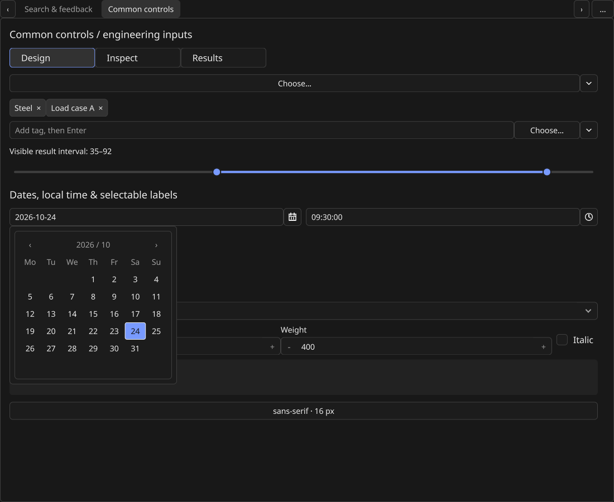

# Search, feedback and remaining common controls (0.26)

Date: 2026-10-24. Tested source:
[`790d039e68144a94decbb4b8627f2dfe1e2a52f9`](https://github.com/jamedev/EStudioUI/commit/790d039e68144a94decbb4b8627f2dfe1e2a52f9).
[Source CI run](https://github.com/jamedev/EStudioUI/actions/runs/40111062486).
The evidence follow-up changes only documentation and actual renderer captures.

## Local acceptance

Final-source Release: **56/56 CTest suites passed**, 17.33 seconds. This includes
real OSMesa framebuffer integrations for the demo, Creator and SQLite browser,
plus the rendering-profile checks. Search/feedback reports **41 contract checks**;
common controls reports **33**. The production productivity gallery reports
**11 GPU/interaction checks**. The compiled search/picker examples and Creator's
direct C++/class exports also build.

The gallery verifies case-folded completion, pointer/keyboard acceptance, shared
Action execution, a notification coexisting with a modal palette, typed interval
bindings, retained/full pixel equality in light and dark, and zero repaint pixels
on unchanged static frames. Calendar and narrow-layout captures come from the
same C++ renderer. These software GL checks establish rendering correctness and
idle-work behavior; they do not measure the user's hardware GPU percentage.

The CPU suites cover timer ordering/cancellation/errors, ready-batch destruction,
receiver expiry, search coalescing and stale/focus/dismissal rejection, duplicate
result validation, owner deletion during publication, modal-safe feedback,
notification bounds, worker inbox overload/closure, immutable log identities,
tag binding rollback, interval crossing/separation, virtual semantic actions,
Gregorian leap/boundary rules, invalid civil drafts, local-time formats, font
validation/cancellation and application-routed links.

Final-source ASan/UBSan: **56/56** suites passed in 88.13 seconds. Leak detection
is disabled because this managed host prevents LeakSanitizer from inspecting its
process/thread tree; address and undefined-behavior checks remain enabled. The
sanitized Creator generator also runs with the same setting.

An additional public-API acceptance executable passes **10 checks** for four-field
time Apply/Cancel, complete font Apply, plain-pointer multiple toggles and tag /
catalog reconciliation while preserving free-form values. A focused composition
probe confirms Enter leaves canonical search text unchanged and composition
active. These are extra local probes, separate from the 56 registered suites.

CI Linux passes **56/56** suites in 34.38 seconds and isolated CPU ThreadSanitizer
passes **6/6** in 3.36 seconds. The isolated native caption probe passes **51**
checks and observes six SC_SIZE scheduler ticks. The exact-source CI run is
complete and all three jobs are green.

| Check | Result |
| --- | --- |
| Windows/MSVC Release, x64-windows-estudioui | 56/56 suites, 10.43 s |
| Windows/MSVC Debug, same triplet | 56/56 suites, 84.56 s |
| Native Win32/WGL software-GL integration | Demo, Creator, database browser and rendering-profile smoke passed |
| Native productivity gallery | 11 actual GPU/interaction checks |
| Native Creator | 70 checks |
| Native database browser | 308 checks |
| Isolated native caption regression | 51 checks; six SC_SIZE scheduler ticks |
| Extra native Debug lifecycle coverage | Five runs, 103 checks each |
| Linux/OSMesa CI | 56/56 suites, 34.38 s |
| Isolated CPU ThreadSanitizer | 6/6 suites, 3.36 s |
| Local ASan/UBSan | 56/56 suites, 88.13 s |

PowerShell 7 parsing and actual Windows PowerShell 5.1 Release/Debug orchestration
pass. CI's explicit `-SkipGpuTest` build stages are followed by actual native
software-GL checks. No C++ compiler warnings were observed in final build/CI
logs. The existing pinned libunibreak port still emits CMake author warnings
about PARENT_SCOPE; no dependency was added or changed.

No hardware performance, interactive IME or real screen-reader speech result is
inferred from software GL or injected composition.

## Scope

No runtime dependency was added. Text selection reuses the single-line read-only
engine; F10b documents and F14 module extraction remain separate. Font catalogs
are explicitly registered resources. Civil values have no implicit timezone or
locale conversion. Log retention is bounded for current storage; applications
retaining old immutable snapshots also retain their data. Rebuild cost is
explicitly linear per log batch, while painting stays viewport-bounded.

Creator registers all 15 new ordinary authorable controls and compiles their
exports. Complete specialized property/value adapters remain future authoring
work. Real Windows assistive-technology speech, physical pointer/IME behavior and
mixed-monitor/hardware performance keep the existing manual acceptance gates.

## Actual C++ renderer captures

The images are direct lossless conversions of final-source framebuffer captures.
They are not mockups. Light/dark retained and full-redraw PPM bytes compare equal
in the automated gallery; unchanged frames report zero repainted pixels.

