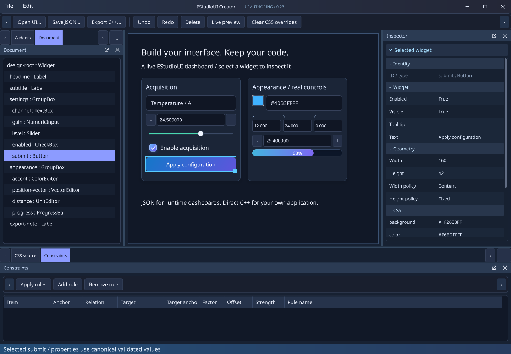
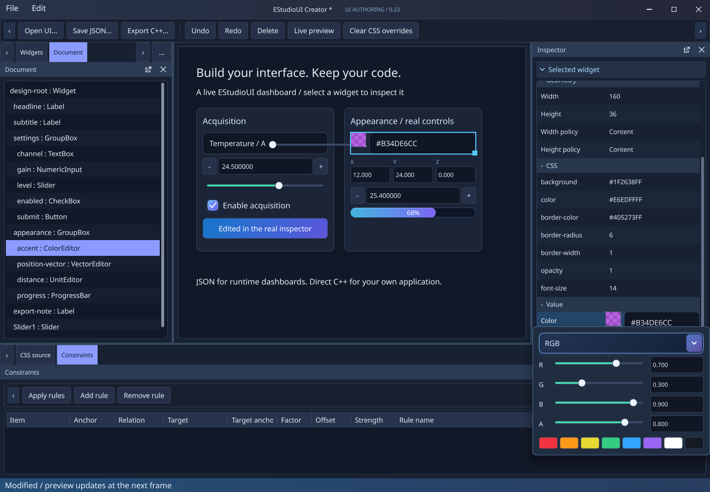
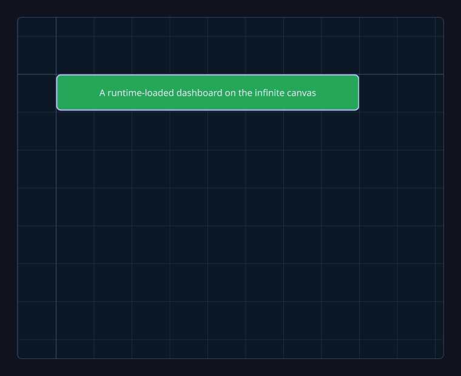

# Property editing and EStudioUICreator: 0.23 verification

This increment adds typed property editing and a first real authoring application.
The source uses the existing EStudioUI renderer; captures below are actual C++
framebuffers, converted losslessly from PPM to PNG. They are not mockups.

## Automated evidence

The final source is `f9176dad8d60eafb17b66dac7d40206fe91d9cb6`.
Local GNU 13 Release passes **46/46 CTest suites**, including the existing GPU
integration and rendering-profile suites. The final complete pass took 17.86 s
on this software-GL host. New suites report:

| Check | Evidence |
| --- | --- |
| PropertyEditing | 38 checks: canonical units and affine conversion, dimension rejection, vector atomicity, RGBA/HSV/hex behavior, passive focus-loss precision, State binding rollback, observer failure recovery, bounded reentrant feedback, 10,000 virtual rows with one editor, lazy semantic edits and dataset expiry |
| UiDocument | 22 checks: JSON round trip, duplicate keys/IDs, versions, bounds, unknown types/properties, invalid references and text, integer grid schema, actual typed construction, constraints, staged failure preserving the host, custom adapters and source escaping |
| CreatorGenerated | 97 checks: a build-time generator exports direct C++ for all 40 registered types, the build compiles that source, and the test compares actual widget identities/geometry and exact UTF-8 label bytes against JSON/runtime construction |
| CreatorGpuIntegration | 24 checks: real inspector commits, preview identity reuse, undo/redo, typed palette creation, JSON/C++ outputs, color popover dismissal, invalid-value rollback, captured movement/resizing, one undo per gesture, zero idle repaint, retained/full framebuffer equality and canvas-hosted runtime widget interaction/placement/pixels |

`examples/PropertyEditing.cpp` and `examples/RuntimeUi.cpp` compile in the ordinary
build. The latter covers both ordinary container and sparse canvas hosting APIs.
The generator does not feed JSON to its generated C++; both paths independently
construct widgets from the same owned design values.

The Release build reports no C++ compiler warnings. The existing libunibreak
package emits its pre-existing CMake developer-scope warnings. An interrupted
earlier build lost generated-file execute permissions; the final clean recovery
build and complete test pass needed no such repair.

Linux CI on this source passes **46/46 suites** in 17.45 s and the separate
**6/6 ThreadSanitizer suites** in 1.77 s. The complete run is
[Build and test / 40027371548](https://github.com/jamedev/EStudioUI/actions/runs/40027371548).

A clean GNU 13 Debug build with `-O1 -g1` and **ASan/UBSan passes 46/46 suites**
in 150.41 s, including Creator and gallery framebuffer checks and the rendering
profile. It uses `ASAN_OPTIONS=detect_leaks=0` and
`UBSAN_OPTIONS=halt_on_error=1`; address and undefined-behavior checks remain
enabled. Leak detection is disabled because this host traces processes.

Windows MSVC 2022 CI passes **47/47 Release suites** in 9.33 s and
**47/47 Debug suites** in 117.68 s. Its real Win32/WGL gallery framebuffer
self-test passes with Mesa 26.2.4 / llvmpipe, the Creator reports **24/24 GPU
checks**, and the native rendering-profile smoke passes. All **five additional
Debug NativePlatform runs pass 99 checks each**. The complete workflow succeeds
on the exact source commit above; both configurations execute the Windows
PowerShell 5.1 `Build.ps1` path. No MSVC C++ compiler warnings are reported.

## Recovery fixes

Windows CI exposed a `MessageBox` macro collision in the Creator, fixed by
undefining the Win32 convenience macro after the native header. Its next Release
run passed all 47 suites but stopped in the existing gallery framebuffer probe:
GLFW silently ignores cursor positioning when foreground activation is declined.
The test helper now positions the actual Win32 cursor through client-to-screen
coordinates and still verifies its position before invoking the production drop
callback. It does not bypass hit testing, owned UTF-8 copying or deferred delivery.
This is a probe correction, not a change to application focus behavior.

A canonical float RGBA value is no longer quantized by an untouched hexadecimal
field losing focus; the new regression observes zero changes. Fresh captures also
exposed squeezed color-channel input text. The compact theme now reserves the
field for its complete value, with keyboard/wheel stepping available.

## Actual renderer captures

The canvas test verifies ordinary pointer activation after construction and
updated host geometry after pan/zoom. Existing canvas hosts resize and relayout
controls when zoom changes the world rectangle; they do not promise uniform
scaling of every glyph or unbounded populations of full widget subtrees.

## Build and platform contracts

`Build.ps1` now builds the Creator, runs its native GPU self-test after the gallery
self-test, and supports `-RunCreator`. It retains Windows PowerShell 5.1 syntax and
the existing pinned `x64-windows-estudioui` triplet. Windows CI stages the Creator
beside the isolated Mesa runtime and runs the real Win32/WGL path. The software
renderer establishes framebuffer correctness, not hardware frame throughput.

Only one new dependency is added: private header-only nlohmann/json 3.11.3#1,
MIT, selected by the existing registry baseline with default features disabled.
The authoritative license is committed and staged with the application.

Native input methods, actual assistive-technology sessions, mixed-monitor DPI,
physical snap/title-bar behavior, and hardware GPU profiling remain human
acceptance work. The new virtual inspector has semantic protocol tests; these do
not substitute for real screen-reader acceptance.

## Deliberate first-increment boundaries

See [CREATOR.md](../CREATOR.md) for the prioritized missing blocks. The initial
adapter catalog constructs 40 actual embeddable widget types, but does not
serialize every type's model, actions, resources or all content pages. Visual CSS
editing covers a first useful subset, with full existing CSS available through a
line-based source editor. The application uses four existing dock groups,
single-selection authoring and bounded snapshot history; it is not a completed
Qt Designer replacement. F10b document editing and F14 extraction remain deferred.
