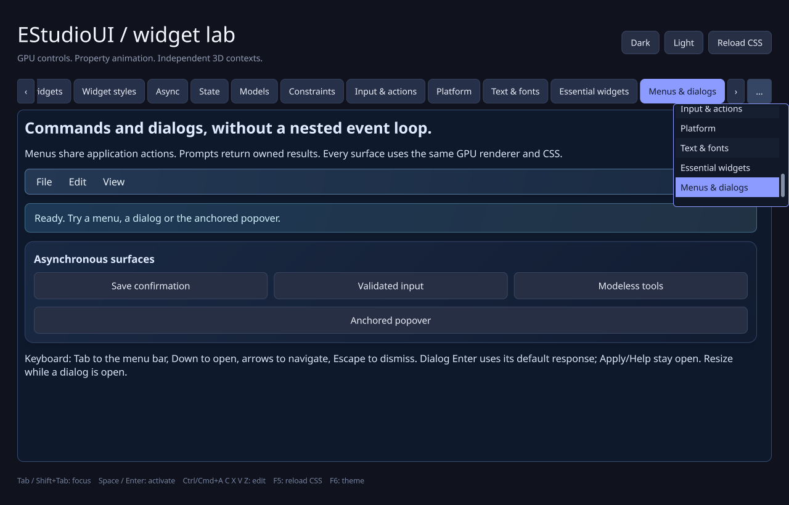

# Rendering profile and navigation follow-up (0.19)

This increment follows Jose's Rich CSS GPU-utilization capture and repeated
Widget styles slider interaction, alongside tab-navigation and misplaced-help
reports. It adds reproducible profiling and fixes input behavior. It does not
replace the renderer, change damage thresholds or introduce a raster text cache.

## Reproduced interaction defects

- Focusing a visible tab recomputed the strip offset from its origin, moving the
  pressed selector before release and cancelling the first click. Reveal now
  preserves the prepared offset and moves only as far as needed. Actual
  press/prepare/release tests verify first-click selection and selected CSS in
  the complete dark and light themes.
- Persistent backward/forward buttons and horizontal/vertical wheel input scroll
  the tab viewport without changing page selection. Selecting/focusing a tab
  minimally reveals it. Oversized captions retain natural width and clip; the
  chooser remains reachable. Tests distinguish a 135.04-pixel caption fitting a
  152-pixel strip from the same caption clipping in a 132-pixel strip.
- Hover help fell back to the keyboard focus target when the hovered tab had no
  tooltip. Hover now resolves only its actual target/logical ancestry; explicit
  keyboard help remains supported. Mouse movement also cancels unrelated focus
  help when the hover path did not change. Weak target checks cover deletion
  during popup dismissal callbacks.

## Measurement implementation

`--profile-rendering` drives the actual Rich CSS page, actual synchronized
Widget styles slider, an isolated effects/flat slider pair, dense mixed-script
TextBox editing/selection and a forced static presentation baseline. All cases
run full and retained redraw with the same requested rate and physical target.
Editing uses fixed-length unique commits rather than repeatedly shaping two
cached strings; pointer selection verifies that unchanged text is not reshaped.
These are current text-control workloads, not a completed rich-document editor.

Each run records entry, warmup, measured and drain phases. There is no synchronous
pixel readback or `glFinish` in the measured path. Four asynchronous timestamps
separate upload commands, retained drawing and the final presentation copy. An
eight-frame ring never waits for a busy slot. Completed samples are matched to
the submitted frame serial; missing samples and coverage remain explicit.
Late samples backfill their original frame and recompute its case summary.

Timestamp counter width is checked. Zero-bit counters leave GPU timing unavailable;
wrapping/nonmonotonic samples are discarded. GPU scopes are elapsed command-stream
intervals, including possible gaps, and exclude native swap and desktop composition.
They do not convert into Task Manager busy percentages. CPU/input/swap wall time,
UI preparation counters, glyph replay, draw calls, upload sizes, dirty-tile area
and full-redraw reasons are separate columns.

The one-shot PS 5.1/7 runner builds/tests Release, captures native driver/build/DPI
metadata and writes reports under ignored `benchmark-local/render-profile-*`.
`-SkipBuild` and `-ExecutablePath` support controlled repeated captures and an
isolated CI software driver. See [PERFORMANCE.md](../PERFORMANCE.md).

## Verification and observations

The implementation is published at `29d32ba`. Local GNU 13 Release passes 39/39
suites in 17.41 seconds, including actual GL framebuffer comparisons and the
profiling smoke. A separate invocation and a CTest rerun each verified all 462
frame rows and 14 summaries, including the final selection/retained drain rows.
An initial truncated host-generated export was discarded rather than accepted
from the process exit code alone. Release generated-object ELF headers were
verified; there are no invalid objects or C++ compiler warnings.

[CI run 39930998023](https://github.com/jamedev/EStudioUI/actions/runs/39930998023)
passes Linux Release/software GL 39/39 in 15.56 seconds and isolated CPU
ThreadSanitizer 6/6 in 1.74 seconds, without compiler warnings or sanitizer reports.
The same run passes MSVC 2022 Release 40/40 in 6.20 seconds and Debug 40/40 in
57.62 seconds, the complete native Win32/WGL framebuffer self-test and native
PowerShell 5.1 profiling smoke with the isolated Mesa 26.2.4 runtime. Five further
native Debug lifecycle runs pass 95 checks each. No MSVC compiler/linker warnings.
Local ASan/UBSan passes 39/39 in 94.35 seconds, including 30.44 seconds for the
complete GL probe and 10.13 seconds for the profiler smoke. No sanitizer reports
or C++ compiler warnings. Empty host-generated objects and stale Ninja dependency
timestamps required artifact repair: affected/stale objects were compiled using
their configured commands, all configured targets were relinked and object/
executable ELF headers were verified before accepting these tests. Leak detection
is disabled under host tracing; native third-party libraries are uninstrumented.
Malformed numeric options, unbound profile options and conflicting benchmark
modes were also checked for a nonzero exit with a useful diagnostic.

## Paced software capture

After compilation and sanitizer tests stopped, the Release profiler ran all
cases with 30 warmup and 180 measured frames at a requested 60 Hz, 1280 x 820
physical/logical pixels, on llvmpipe LLVM 17 / Mesa 24.0.5. All 3,178 unique frame
rows, including 2,520 measured rows, 14 summaries and each matched GPU-stage sum
were validated before accepting the capture. Every measured run matched 180/180
GPU samples. The retained runs achieved about 59.3..59.7 scripted frames/s on
this software renderer; this is neither hardware throughput nor normal idle load.

| Retained workload | Mean analytic repaint area | Mean replayed glyph instances |
| --- | ---: | ---: |
| Forced static presentation | 0% | 0 |
| Actual Rich CSS animations | 13.177% | 140.94 |
| Actual synchronized Widget styles slider | 2.589% | 20.33 |
| Isolated slider with effects | 4.540% | 7.07 |
| Same slider without gradients/shadows | 4.423% | 5.60 |
| Dense text, fresh suffix edits | 0.390% | 5.00 |
| Dense text, pointer selection | 0.963% | 78.85 |

There were no area/rectangle-budget fallbacks in these measured retained runs.
The deliberate correctness probe separately verifies that sparse fragmentation
still reports its original dirty area when the seventeenth region selects a full
redraw. The text-selection case performs no fresh shaping after warmup. Actual
slider dragging includes numeric/status updates; the isolated pair omits them.

The current retained renderer therefore avoids whole-window analytic repaint
for these tested interactions. Every forced frame still copies the complete
retained image for presentation. Effects/flat timing differences in the supplied
CSV describe this CPU renderer; they do not identify the dominant cost or expected
gain on Jose's GPU. Hardware capture should decide between effect/text caching,
buffer submission improvements and presentation work. No Vulkan/atlas rewrite or
damage-budget adjustment is justified by these software times alone.

- [Software summary CSV](render-profile-software-0-19.csv)
- [Software driver/build/DPI metadata](render-profile-software-0-19.json)

Run `.\scripts\Profile-Rendering.ps1` on the target Windows GPU, or use
`-SkipBuild -Case widget-styles -Frames 600` for a longer isolated case group.
The summary and metadata identify the device and timing scopes; frame CSV retains
individual peaks for further analysis.

The actual C++ framebuffer below shows the minimally revealed end tab, both
navigation arrows and the virtual chooser. It is a lossless conversion of the
GPU self-test capture, not a hand-built preview.

Hardware GPU timings remain a target-platform measurement. This host exposes
OSMesa/llvmpipe only. Native Windows software-GL smoke checks validate Win32/WGL,
PowerShell and accounting paths, without establishing hardware speed or predicting
the utilization in Jose's capture. Hardware comparison should use the same build,
physical resolution, DPI, rate and workload.
