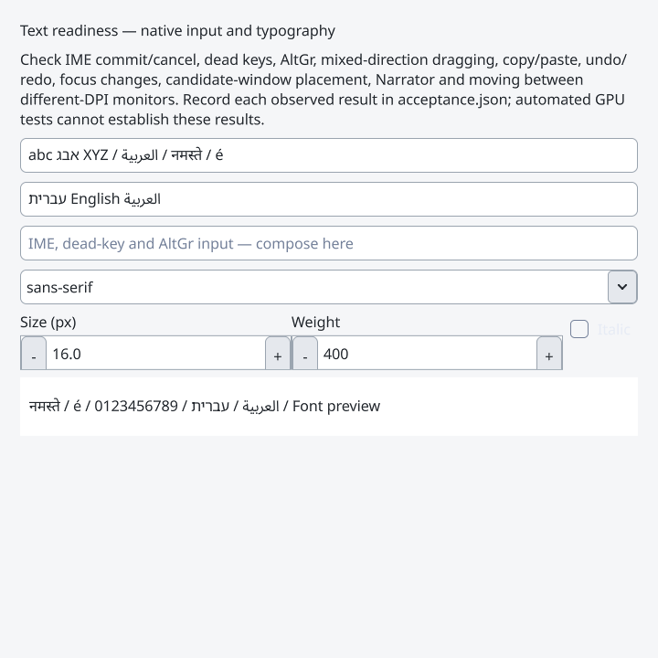

# Text-readiness hardening (0.26.1)

Date: 2026-10-24. Tested source:
[`1eb7a5d55b44094d5623a9c1f3c4adf2825fa26f`](https://github.com/jamedev/EStudioUI/commit/1eb7a5d55b44094d5623a9c1f3c4adf2825fa26f).
[Source CI run](https://github.com/jamedev/EStudioUI/actions/runs/40116769364).
The follow-up adds documentation, raw verification data, lossless conversions of
actual C++ framebuffer captures and the one-byte test-fixture cleanup described
below. Runtime sources are unchanged from the tested commit.

## Local verification

Final-source Release: **57/57 CTest suites passed**, 29.38 seconds, including
real OSMesa framebuffer checks for the demo, Creator and database browser and the
existing rendering-profile smoke. Compiled public examples and Creator's direct
C++/class exports build. The new TextReadiness CPU suite passes **38 checks**:
shared family/language validation, malformed UTF-8 and boundary rejection,
complete preview fields, bound-candidate rollback, editable incomplete drafts,
deterministic paragraph inventory and bounded exact shape reuse.

The new GPU probe passes **134 checks**. A configured **8,064-byte** glyph budget
forces **59 evictions and 11 compactions**, preserving current-frame glyphs
including an instance recorded before a later miss. Every churn frame compares
exactly with an independent full-redraw renderer, including transformed rounded
clipping and translucent overlap. The identical following frame has zero
analytic draw calls, repainted pixels and font uploads.

The probe verifies single-glyph versus visible-working-set admission reasons,
required-byte diagnostics, refusal to submit a failed recording, abort during a
prospective resize, preserved last-frame pixels/serial/capture and subsequent
recovery. Offscreen text and whitespace admit no glyphs or font uploads. The
focused native acceptance window builds through ordinary framework widgets.

Final-source ASan/UBSan: **57/57 suites passed**, 146.65 seconds, including the
actual framebuffer integrations and profile smoke. Leak detection is disabled
because this managed host prevents LeakSanitizer from inspecting its process/
thread tree; address and undefined-behavior checks remain enabled. The sanitized
Creator generator runs under the same setting.

Source CI Linux: **57/57 suites passed**, 32.20 seconds. Isolated CPU
ThreadSanitizer: **6/6**, 3.20 seconds. The independent native Windows caption
regression passes **51 checks** with six SC_SIZE scheduler ticks.

The exact-source CI run completed with all three jobs green:

| Check | Result |
| --- | --- |
| Windows/MSVC Release, x64-windows-estudioui | 57/57 suites, 9.86 s |
| Windows/MSVC Debug, same triplet | 57/57 suites, 95.09 s |
| Native Win32/WGL software OpenGL | Demo, Creator, database browser, existing rendering-profile smoke and new text profile passed |
| Native text-readiness probe | 134 actual framebuffer/cache checks |
| Native Creator / database browser | 70 / 308 checks |
| Independent native caption regression | 51 checks; six SC_SIZE scheduler ticks |
| Additional native Debug lifecycle runs | Five runs, 103 checks each |
| Linux/OSMesa CI | 57/57 suites, 32.20 s |
| Isolated CPU ThreadSanitizer | 6/6 suites, 3.20 s |
| Local ASan/UBSan | 57/57 suites, 146.65 s |

PowerShell 7 parsing and Windows PowerShell 5.1 Release/Debug orchestration
pass. The new acceptance script also runs in PrepareOnly mode and creates its
JSON scaffold under Windows PowerShell 5.1. The native text profile completes
its full deterministic workload with the staged software-GL driver.

CI reports C4310 in both configurations for the test's deliberate
`char(0xff)` conversion, used to construct invalid UTF-8. The follow-up replaces
that conversion with the equivalent one-byte `"\xff"` string. The focused
TextReadiness suite is rebuilt and rerun locally in Release and ASan/UBSan
(38 checks; 0.04 / 0.29 seconds). No runtime source or other compiled input
changes. A second full native CI run is not claimed for this test-data-only
spelling change. No other C++ compiler warnings were observed; the pinned
libunibreak port retains its existing CMake author warnings about PARENT_SCOPE.

## Stress corpus and interpretation

The actual renderer's `--text-profile` emits 480 readback-free samples across
four deterministic fixture inventories and five phases: cold/warm, scrolling,
editing, font churn and wrapping. The inventory contains 100,000 paragraphs,
but each frame explicitly requests only its bounded visible fixture count.
This proves fixture/work accounting, not a delivered virtualized document engine.

The 64 KiB paragraph does not fit the control service's 4 MiB exact-shape LRU and
is reshaped on repeated requests. Wrapping computes the requested paragraph.
F10b therefore needs retained paragraph/line layout ownership independent of that
short-run cache, paragraph-local edit invalidation and an explicit strategy for
long paragraphs. Short requested paragraphs reuse their exact shapes. These
observations establish work boundaries; software-GL timing is not a target-GPU
throughput or utilization claim.

| Cold/warm fixture | Stored / requested paragraphs | Shapes across 24 frames | Font uploads / repaint after frame 1 |
| --- | --- | --- | --- |
| Many short paragraphs | 100,000 / 32 | 32 | 0 / 0 |
| One 64 KiB paragraph | 1 / 1 | 24 | 0 / 0 |
| Mixed scripts | 128 / 16 | 16 | 0 / 0 |
| Repeated wrapping inputs | 32 / 8 | 1 | 0 / 0 |

[Raw text-profile samples](text-readiness-profile.csv) and
[small-cache churn counters](text-cache-churn.csv) are copied unchanged from the
final-source C++ runs. The local text profile ran on Mesa llvmpipe while a
sanitizer build was active. Its CPU/GPU times are diagnostic observations under
shared software-rendering/build load, not a hardware acceptance baseline. The
wrapping-input fixture deliberately repeats identical paragraph text, allowing
one exact shaped result to serve several requested paragraphs in its no-wrap phase.

No runtime dependency was added. No document-editor storage/widget, rich text,
multiline accessibility implementation, Vulkan backend or module extraction is
claimed. See [the public contract and commands](../TEXT_READINESS.md).

## Human acceptance remains open

The PowerShell runner creates an owning `acceptance.json` with source/executable
identity, OS/driver metadata and specific IME/keyboard/selection/clipboard/focus/
DPI/Narrator/hardware steps. Every human result starts **NotTested** and is never
automatically promoted to Passed. This Linux-host session did not observe real
Japanese/Chinese/Korean IMEs, dead keys/AltGr, Narrator speech, physical
mixed-monitor scaling or target-GPU performance. Automated Win32/provider and
software-GL checks do not replace those sessions.

## Actual renderer captures

The images below are lossless conversions of final-source framebuffer captures.

