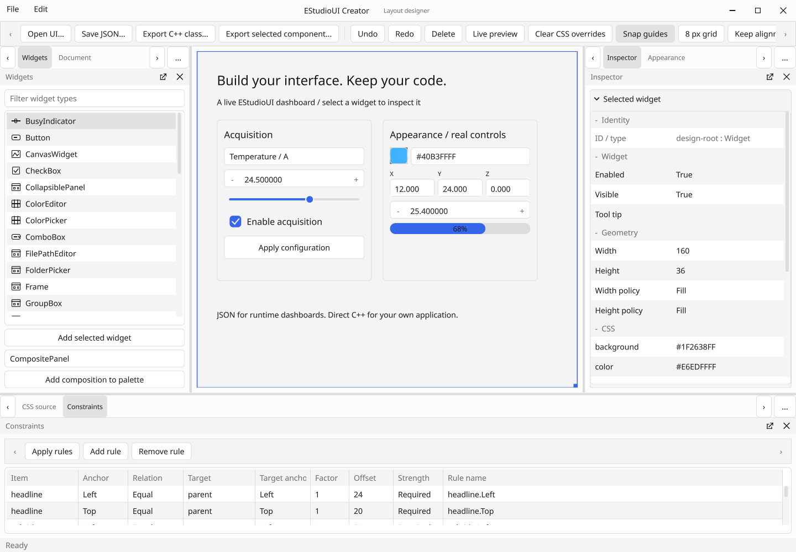
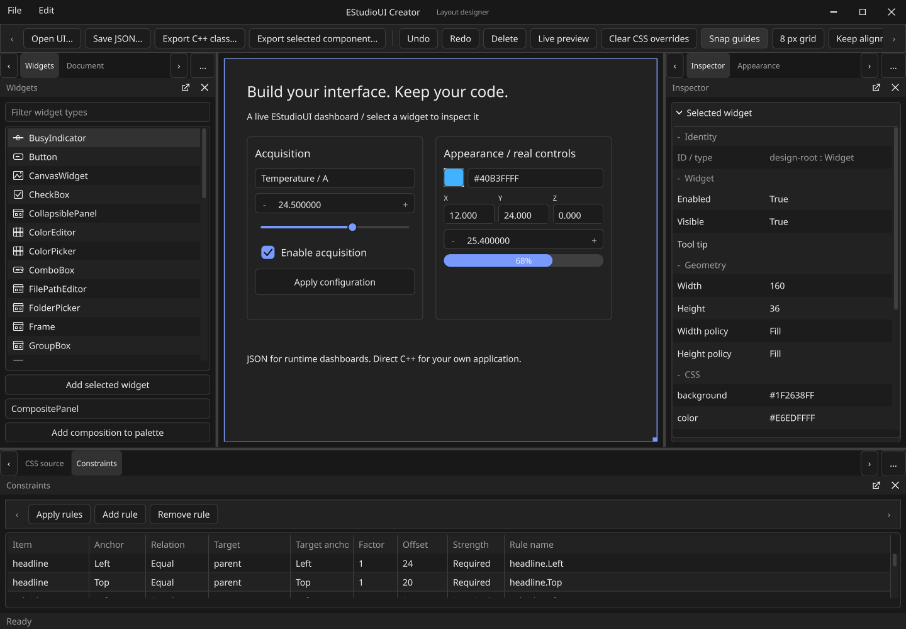
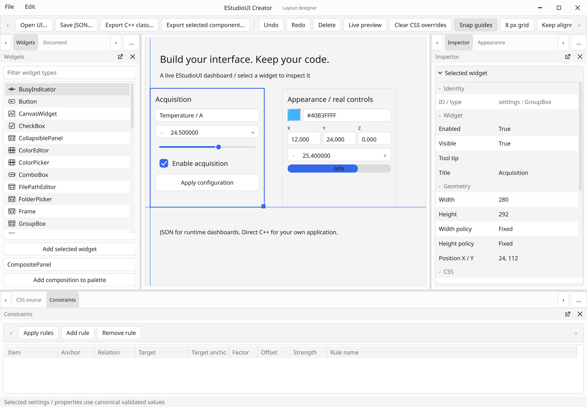

# Themes and Creator authoring follow-up

Date: 2026-10-24. Verified source: `641b0671886c3ae1f41b95909aeccebf8a87ae8e`.
This follows the 0.23 property/Creator and native-title-bar work.

## Delivered behavior

- Minimal is the neutral default. Engineering, Office, Studio, Game and System
  families each offer light/dark, System mode and bounded customization.
- Window-owned controllers compile CSS only when its source changes, preserve
  widgets, accept layered application CSS and yield to explicit raw stylesheets.
- Windows appearance observations use owned snapshots and coalesced idle delivery;
  unsupported platforms and headless emulation remain explicit.
- The Creator palette paints category icons for visible rows, supports captured
  drag insertion into nested registered content slots, and commits one undo edit.
- Moving/resizing under Constraints shows container/sibling snap guides, with
  optional parent-relative grid and persistent ordinary solver anchors.
- Selected subtrees can become reusable session compositions with remapped IDs;
  independent instances persist through ordinary open JSON.
- Class export produces a complete editable .h/.cpp pair with owned construction,
  typed observer members and guidance for application hooks. Runtime JSON and the
  original direct-function C++ export remain available independently.

## Local verification

GCC 13 Release builds successfully. All **48/48 CTest suites pass**, including
actual GLFW null/OSMesa framebuffer tests and rendering-profile smoke checks.
The Theme suite has **59 assertions**: twelve presets, real style resolution,
unchanged-source reuse, coalesced preferences, contrast/motion rules, invalid
configuration rollback, override CSS, raw stylesheet handoff and recursive pump
rejection. The pure snapping fixture has **5 checks** for container/sibling axes,
resizing, a parent-relative grid and disabling the feature.

The Creator GPU probe exercises actual captured pointer drag/drop into a nested
GroupBox, one-step undo, reusable compositions/JSON, visible snap guides, persistent
parent anchors, all twelve appearance variants and widget identity retention.
The probe reports **45 checks**. Its previous inspector, real popup, runtime canvas, retained/full pixel equivalence
and window-chrome probes also continue to run. The generated catalog class header
and source are compiled and instantiated; every registered embeddable type is
present. The small theme API example in THEMES.md compiles against delivered
headers. A library-only CMake configuration also succeeds with Creator, gallery
and tests disabled; it exposes only the framework and GL library targets.

An early run exposed and corrected inactive Inspector ownership, raw geometry
fixtures unintentionally using new snapping, unwanted window padding, missing
primary-hover feedback and collection part rules overriding canonical explicit
selection colors. Final complete Release checks passed after these corrections.

MinGW syntax-checks the native appearance adapter's fallback path. Its SDK lacks
C++/WinRT and the native test's UI Automation headers; the separate MSVC CI
build exercises the Windows SDK implementation. The complete ASan/UBSan build also passes **48/48 suites**, including both GPU
checks (leak detection disabled for the external software-GL runtime; UBSan halts
on error). GitHub Linux CI independently passes **48/48** integration/core suites
and **6/6** isolated ThreadSanitizer suites. Windows MSVC 2022 CI passes **49/49 suites in both Release and Debug**, the
native WGL/Mesa gallery/Creator framebuffer and profile smoke checks, and five
repeated native Debug lifecycle probes (**103 checks each**). Windows Creator
reports **69 checks**, including 24 actual GLFW/native-caption checks; the isolated
Win32 frame-adapter regression also passes. No MSVC `warning C` diagnostics were
reported. See the completed green [run 40052853073](https://github.com/jamedev/EStudioUI/actions/runs/40052853073).

## Performance and acceptance limits

The presets use existing GPU shapes/text and ordinary compiled CSS. Visible-row
palette icons are bounded paint records, not child widgets. Ordinary unchanged
frames add no OS appearance query, stylesheet parse or recurring theme timer.
The unchanged Creator repaint and retained/full framebuffer checks still pass.
Software GL proves rendering correctness, not hardware GPU load or frame rate.

Native appearance is implemented on Windows. Linux/macOS GLFW adapters currently
report Unsupported; they use deterministic fallback colors rather than guessed
OS preferences. Matching OS colors is not a promise of identical native controls.
Physical desktop appearance changes, mixed-DPI monitors, actual AT/high-contrast
use and hardware GPU measurements remain human/platform acceptance work.

Theme preferences and the 64-entry composition palette are session settings.
Composition instances are independent flattened subtrees, not linked instances.
Existing-widget reparenting, multi-selection, multiple authored content slots,
scoped subtree styles, persistent component catalogs and safe user-code merging
on regeneration remain future increments. C++ re-export deliberately replaces
the chosen source pair; retain custom additions before regeneration.

## Renderer captures

These 1440 × 1000 images are lossless conversions of PPM files written by
`EStudioUICreator --headless --self-test`; decoded RGB pixels were checked equal.
The renderer is llvmpipe / Mesa 25.1.7 in this local environment. The gallery's
initial dark fixture remains one draw call (28 shapes and 865 glyph instances);
this is a correctness/submission observation, not a hardware timing result.

Decoded RGB SHA-256 hashes are stored in [theme-capture-hashes.json](theme-capture-hashes.json).
