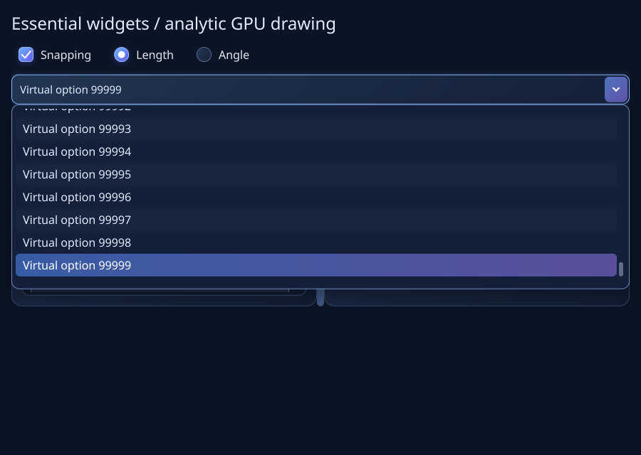
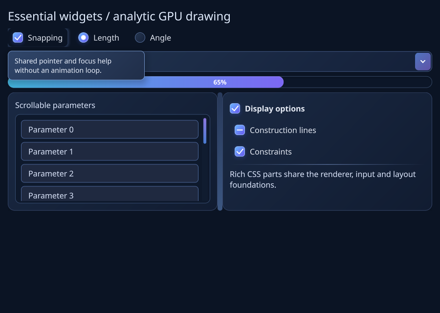

# Essential widget batch verification (0.18)

Delivered: W01, W02, W03, W14, W16, W18, W07 and W25. Public contracts and explicit
limits are in [COMMON_CONTROLS.md](../COMMON_CONTROLS.md). The small public example
and the interactive gallery compile against the delivered headers.

Release regression: 37/37 Linux CTest suites pass, including 75 checks in
EssentialWidgets and the actual software-GL framebuffer integration (12.28
seconds total). No compiler warnings. The public CommonControls example compiles.
Sanitizer and Windows results are recorded after their final runs.

The new CPU fixture checks three-state choices, shared boolean bindings/actions,
coherent exclusive selection, keyboard activation/navigation, wrong-thread and
reentrant rejection, callback deletion, a 100,000-record virtual combo, Unicode
case-folded completion, disabled choices, model-candidate validation, shared stable
selection, popup preview/accept/cancel, editable text, detached setup, a single Tab
stop, arbitrary form focus reveal, measurement reuse, pointer/keyboard splitters,
hard minima, hidden-pane identity, checkable groups, progress/idle behavior and
nonactivating delayed/modal help. It reuses the foundation tests for composition,
layout, models, actions and dispatch.

Actual GPU checks cover gradient progress pixels, unchanged retained reuse,
bit-identical full/retained rendering, repaint without intrinsic remeasurement,
100,000-record popup culling with bounded glyph count, cancellation, tooltip pixels
and exact dismissal restoration, actual scrolling focus reveal, captured pane
dragging and intermediate resize dimensions preserving hard minima. Captures are
from the C++ renderer, converted losslessly from PPM. Driver: Mesa llvmpipe 4.5 /
LLVM 17 software GL. This is behavioral and work-bound evidence, not hardware FPS.

NativePlatform extends Windows provider checks with indeterminate toggles, combo
expansion/collapse and read-only values, progress policy and radio selection.
The existing Build.ps1 still installs x64-windows-estudioui dependencies, builds
and tests in one shot. Hosted Windows CI skips OpenGL explicitly; native GPU
verification remains enabled by default on a developer workstation.

F10a prerequisite evidence is complete at a1ab5bd: Windows Release 38/38, Debug
38/38 and three extra native Debug runs of 83 checks, zero compiler warnings;
Linux CI Release/software GL and TSan pass. Local ASan/UBSan 36/36 passes.
[Run](https://github.com/jamedev/EStudioUI/actions/runs/39877185004).
The [human platform checklist](PLATFORM_ACCEPTANCE.md) remains open for installed
input methods, Narrator and mixed-monitor observations.

